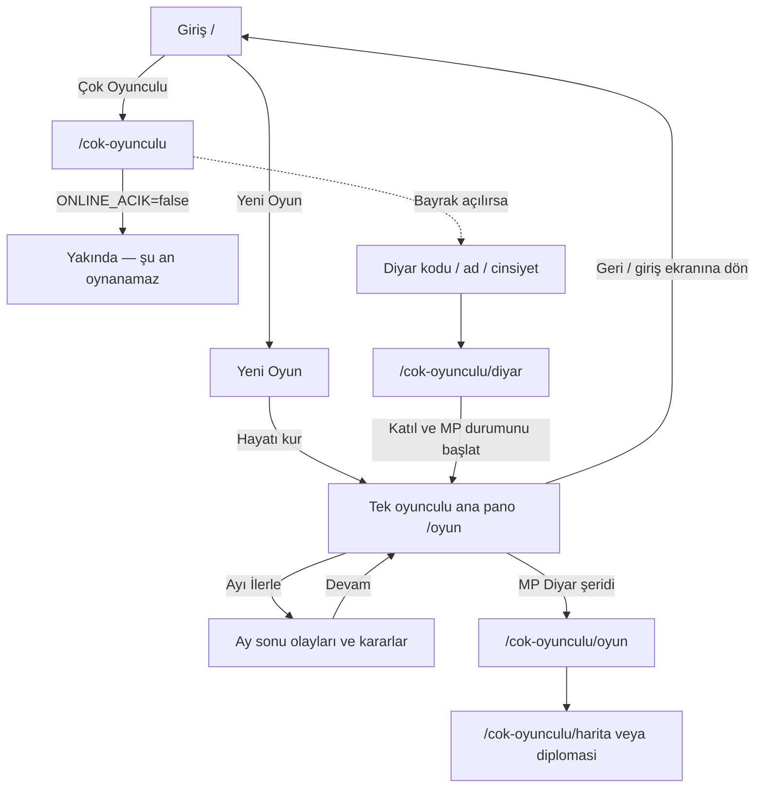
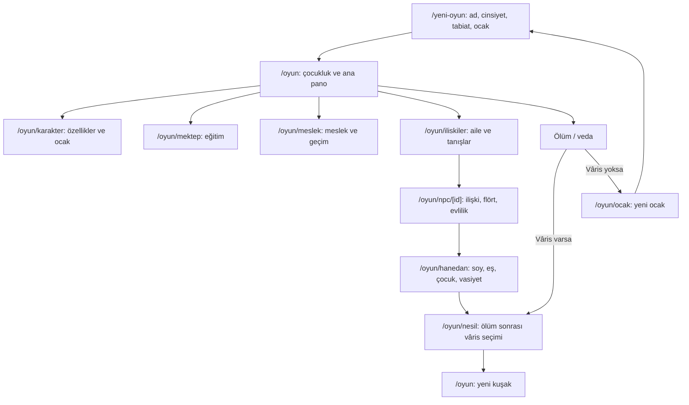

# EKRAN_HARITASI

> Kapsam: `Tayma96/kroniklerorj` / `apk` dalı. Rota envanteri `mobile/lib/screen-design.ts` ile karşılaştırıldı; ekran dosyaları ve gezinme çağrıları incelendi. Bu belge dışında kaynak kod değiştirilmedi.

## 1. Ekran envanteri

### Giriş ve tek oyunculu

| Ekran / dosya | İşlev (1 cümle) | Nereden / nasıl ulaşılır |
|---|---|---|
| `mobile/app/index.tsx` — `/` | Devam, yeni hayat ve çok oyunculu giriş seçeneklerini sunar. | Uygulama açılışı; ana kök. |
| `mobile/app/yeni-oyun.tsx` — `/yeni-oyun` | Ad, cinsiyet, tabiat ve doğulan ocak seçimleriyle hayatı kurar. | Giriş > Yeni Oyun; Ayarlar/Menü/Ana sayfa > Yeni Hayat; geri ile giriş. |
| `mobile/app/sinematik.tsx` — `/sinematik` | Açılış sinematiğini oynatır ve oyuna geçirir. | Ayarlar > Açılışı yeniden izle; bitiş/atla > `/oyun`. |
| `mobile/app/oyun/index.tsx` — `/oyun` | Hayatın ana panosunu, olayları, kararları ve ay ilerletmeyi gösterir. | Giriş > Devam; yeni hayat tamamlanınca; ay ilerlet düğmesi; vâris/ocak dönüşü. |
| `mobile/app/oyun/karakter.tsx` — `/oyun/karakter` | Özellik, kuşam, ocak ve serüven bilgilerini sekmelerde toplar. | Alt sekme Karakter; ana sayfa ve bazı görev bağlantıları; ayarlar bağlantısı. |
| `mobile/app/oyun/iliskiler.tsx` — `/oyun/iliskiler` | Aileyi, yakınları, hasımları ve tanışları listeler. | Alt sekme İlişkiler; Şehir/Menü; NPC ve mahalle bağlantıları. |
| `mobile/app/oyun/menu.tsx` — `/oyun/menu` | Şehir, güç, aile ve kayıt/defter ekranlarına açılan merkezi menüdür. | Alt sekme Menü. |
| `mobile/app/oyun/sehir.tsx` — `/oyun/sehir` | Bulunulan şehrin durumunu ve mekân girişlerini gösterir. | Menü kahraman alanı > Şehre Çık; geri ile önceki ekran. |
| `mobile/app/oyun/harita.tsx` — `/oyun/harita` | Beylikleri ve yerleşimleri haritada gezdirir. | Menü > Harita; Şehir > Diyarı Gez. |
| `mobile/app/oyun/diyar/[name].tsx` — `/oyun/diyar/[name]` | Seçilen yerleşimin yönetim, vergi ve yolculuk ayrıntılarını gösterir. | Harita üzerinde yerleşim seçimi. |

### Geçim, eğitim ve güç

| Ekran / dosya | İşlev (1 cümle) | Nereden / nasıl ulaşılır |
|---|---|---|
| `mobile/app/oyun/atolye.tsx` — `/oyun/atolye` | Üretim ve atölye siparişlerini yönetir. | Menü > Şehir; Şehir > Atölye. |
| `mobile/app/oyun/pazar.tsx` — `/oyun/pazar` | Alım-satım, pazarlık ve kervan işlemlerini yürütür. | Menü > Şehir; Şehir > Pazar; ana sayfa kısayolu. |
| `mobile/app/oyun/meslek.tsx` — `/oyun/meslek` | Meslek, lonca sınavı, çırak ve ustalık ilerlemesini yönetir. | Menü > Şehir; çok oyunculu kişisel ekran kısayolu; Savaş içi meslek bağlantısı. |
| `mobile/app/oyun/emek.tsx` — `/oyun/emek` | Emeği geçenler/teşekkür içeriğini gösterir. | Ayarlar > Emeği Geçenler. |
| `mobile/app/oyun/mulkler.tsx` — `/oyun/mulkler` | Mülk alımını ve mülklerin işletilmesini yönetir. | Menü > Şehir; Şehir > Mülkler; çok oyunculu kişisel ekran kısayolu. |
| `mobile/app/oyun/beceriler.tsx` — `/oyun/beceriler` | Oyuncunun beceri ve hüner gelişimini gösterir. | Menü > Güç; Mektep; çok oyunculu kişisel ekran kısayolu. |
| `mobile/app/oyun/mektep.tsx` — `/oyun/mektep` | Eğitim, ders ve sınav seçeneklerini sunar. | Menü > Şehir; Şehir > Mektep; çok oyunculu kişisel ekran kısayolu. |
| `mobile/app/oyun/gorevler.tsx` — `/oyun/gorevler` | Açık ve bekleyen görevleri listeler, ilgili hedefe götürür. | Menü > Şehir; görev kartı bağlantıları. |
| `mobile/app/oyun/orgutler.tsx` — `/oyun/orgutler` | Lonca, örgüt ve güç mücadelelerini yönetir. | Menü > Güç; Şehir > Örgütler; çok oyunculu kişisel ekran kısayolu; haber bağlantısı. |
| `mobile/app/oyun/savas.tsx` — `/oyun/savas` | Düello, talim ve savaş kararlarını oynatır. | Menü > Güç; çok oyunculu kişisel ekran kısayolu; görev/olay bağlantıları. |
| `mobile/app/oyun/suc.tsx` — `/oyun/suc` | Suç, keşif, kovalamaca ve kadı sürecini yönetir. | Menü > Güç; ilgili olay/karar bağlantıları. |

### Aile, sosyal hayat ve kişiler

| Ekran / dosya | İşlev (1 cümle) | Nereden / nasıl ulaşılır |
|---|---|---|
| `mobile/app/oyun/mahalle.tsx` — `/oyun/mahalle` | Mahalle mekânlarını ve oralardaki kişileri gösterir. | Menü > Şehir; Şehir > Mahalle; İlişkiler boş durum/kısayolu. |
| `mobile/app/oyun/sosyal.tsx` — `/oyun/sosyal` | Söylentileri ve sosyal etkileşimleri yönetir. | Menü > Güç; NPC/olay bağlantıları. |
| `mobile/app/oyun/copcatan.tsx` — `/oyun/copcatan` | Uygun bekâr oyuncuya talip önerileri sunar. | İlişkiler > Çöpçatan. |
| `mobile/app/oyun/ocak.tsx` — `/oyun/ocak` | Aile/ocak bilgisini ve ölüm sonrası yeni ocak akışını gösterir. | Ölüm sonrası ana sayfa > Küllerden Yeni Ocak; akış sonunda ana sayfa. |
| `mobile/app/oyun/nesil.tsx` — `/oyun/nesil` | Ölüm sonrası vâris seçimi ve nesil devrini yürütür. | Ölüm sonrası ana sayfa; Hanedan > Nesil; seçim tamamlanınca ana sayfa. |
| `mobile/app/oyun/hanedan.tsx` — `/oyun/hanedan` | Soy, vasiyet, taht, servet ve hanedan ilişkilerini yönetir. | Menü > Aile; Şehir > Hanedan; ana sayfa ölüm/soy bağlantıları. |
| `mobile/app/oyun/npc/[id].tsx` — `/oyun/npc/[id]` | Tek bir NPC'nin profilini, sohbetini ve kişisel eylemlerini açar. | İlişkiler, Mahalle, Hanedan ve söylenti/kişi bağlantıları. |
| `mobile/app/oyun/diplomasi.tsx` — `/oyun/diplomasi` | Beyliklerle ilişkileri ve diplomatik kararları gösterir. | Hanedan içindeki Diplomasi bağlantısı. |

### Kayıt, anlatı ve sistem

| Ekran / dosya | İşlev (1 cümle) | Nereden / nasıl ulaşılır |
|---|---|---|
| `mobile/app/oyun/haberler.tsx` — `/oyun/haberler` | Diyar haberlerini gösterir ve haberi ilgili sisteme bağlar. | Menü > Şehir; Şehir > Haberler; haber kartı içi bağlantılar. |
| `mobile/app/oyun/tarih.tsx` — `/oyun/tarih` | Hayatın olay geçmişini/Yaşam Defteri'ni gösterir. | Menü > Defter; ana sayfa defter bağlantısı. |
| `mobile/app/oyun/kronik.tsx` — `/oyun/kronik` | Hanedanın soy/kronik kaydını gösterir. | Menü > Aile > Kronik. |
| `mobile/app/oyun/roman.tsx` — `/oyun/roman` | Tamamlanan hayatın anlatı/roman kaydını gösterir. | Ölüm/veda penceresi > Kroniği oku. |
| `mobile/app/oyun/hikayeler.tsx` — `/oyun/hikayeler` | Hikâye yaylarını başlatır ve sürdürür. | Menü > Defter. |
| `mobile/app/oyun/divan.tsx` — `/oyun/divan` | Günün divan davası ekranını içerir. | **Mevcut menüden bağlantısı yok**; menü verisinde tek oyunculudan kaldırıldığı açıkça belirtilmiş. |
| `mobile/app/oyun/basarimlar.tsx` — `/oyun/basarimlar` | Kazanılan başarımları listeler. | Menü > Defter. |
| `mobile/app/oyun/ayarlar.tsx` — `/oyun/ayarlar` | Ses, erişilebilirlik, yardım, sinematik ve sıfırlama ayarlarını sunar. | Menü başlığındaki dişli; Karakter ekranı > Ayarlar. |
| `mobile/app/oyun/sss.tsx` — `/oyun/sss` | Nasıl oynanır ve sık sorulan soruları açıklar. | Ayarlar > Nasıl Oynanır/SSS. |

### Klasik çok oyunculu (`cok-oyunculu/*`)

| Ekran / dosya | İşlev (1 cümle) | Nereden / nasıl ulaşılır |
|---|---|---|
| `mobile/app/cok-oyunculu/index.tsx` — `/cok-oyunculu` | Diyar koduyla katılma/oda kurma, ad ve cinsiyet girişini sunar. | Ana giriş > Çok Oyunculu; oyun üst şeridinden diyarı terk edince geri dönüş. |
| `mobile/app/cok-oyunculu/diyar.tsx` — `/cok-oyunculu/diyar` | Seçilen diyara katılır, MP durumunu kurar ve ortak oyun panosuna geçirir. | Çok Oyunculu lobisinde kod/oda seçimi. |
| `mobile/app/cok-oyunculu/oyun.tsx` — `/cok-oyunculu/oyun` | Aktif diyarın oyuncu, taht, sohbet ve ortak durum ayrıntılarını gösterir. | MP modunda `/oyun` ana sayfasındaki Diyar şeridi. |
| `mobile/app/cok-oyunculu/harita.tsx` — `/cok-oyunculu/harita` | Ortak diyarın haritasını gösterir. | Diyar ayrıntıları > Harita. |
| `mobile/app/cok-oyunculu/diplomasi.tsx` — `/cok-oyunculu/diplomasi` | Ortak diyarın diplomasi/oyuncu ilişkileri kararlarını gösterir. | Diyar ayrıntıları > Diplomasi. |

### Yeni çevrimiçi akış (`online/*`)

| Ekran / dosya | İşlev (1 cümle) | Nereden / nasıl ulaşılır |
|---|---|---|
| `mobile/app/online/index.tsx` — `/online` | Çevrimiçi giriş/oturum ve geliştirici deneme girişini sunar. | Ayrı çevrimiçi akışın kökü; ana girişte doğrudan bağlantı yok. |
| `mobile/app/online/profil.tsx` — `/online/profil` | Çevrimiçi oyuncu adı ve kimliğini oluşturur/düzenler. | Online giriş > Profil; hata/oturum dönüşü. |
| `mobile/app/online/yerlesim.tsx` — `/online/yerlesim` | Beylik ve başlangıç yerleşimi seçtirir. | Profil > Yerleşim. |
| `mobile/app/online/davet.tsx` — `/online/davet` | Davet koduyla yerleşime katılmayı sağlar. | Yerleşim seçiminden Davet seçeneği. |
| `mobile/app/online/varis.tsx` — `/online/varis` | Çevrimiçi hayata varış/başlangıç sunumunu gösterir. | Yerleşim veya davet tamamlanınca; devam > Yaşam. |
| `mobile/app/online/yasam.tsx` — `/online/yasam` | Çevrimiçi hayatın ana panosunu ve hızlı bağlantılarını sunar. | Varış > Devam; alt menü Yaşam. |
| `mobile/app/online/mahalle.tsx` — `/online/mahalle` | Çevrimiçi yerleşimin mahalle haritasını ve kişilerini gösterir. | Online alt menü > Mahalle. |
| `mobile/app/online/kisi/[id].tsx` — `/online/kisi/[id]` | Yerleşimdeki NPC/kişinin profilini açar. | Mahalle, Tanıdıklar veya karakter içi kişi bağlantıları. |
| `mobile/app/online/tanidiklar.tsx` — `/online/tanidiklar` | Çevrimiçi karakterin tanıdık listesini gösterir. | Online alt menü > Tanıdıklar. |
| `mobile/app/online/karakter.tsx` — `/online/karakter` | Çevrimiçi karakterin durum ve gelişimini gösterir. | Online alt menü > Karakter. |
| `mobile/app/online/meslek.tsx` — `/online/meslek` | Çevrimiçi meslek ve lonca gelişimini yönetir. | Yaşam/iş bağlantıları; Meslek ekranı içinden İşler ve Lonca. |
| `mobile/app/online/isler.tsx` — `/online/isler` | Çevrimiçi iş/çalışma eylemlerini yürütür. | Meslek veya Lonca > İşler. |
| `mobile/app/online/lonca.tsx` — `/online/lonca` | Çevrimiçi lonca ve sipariş bağlantılarını gösterir. | Meslek/İşler/Siparişler > Lonca. |
| `mobile/app/online/siparisler.tsx` — `/online/siparisler` | Çevrimiçi lonca siparişlerini listeler ve teslim ettirir. | Yaşam, İşler veya Lonca > Siparişler. |
| `mobile/app/online/oyuncu/[id].tsx` — `/online/oyuncu/[id]` | Başka bir gerçek oyuncunun profilini gösterir. | Mahalle/oyuncu listesi bağlantıları. |
| `mobile/app/online/gelen.tsx` — `/online/gelen` | Oyuncuya gelen sosyal bildirim/istekleri listeler. | Oyuncu profili/etkileşim bağlantıları. |
| `mobile/app/online/beceri-agaci.tsx` — `/online/beceri-agaci` | Mesleğe bağlı beceri ağacını gösterir. | Oyuncu veya Meslek > Beceri Ağacı. |
| `mobile/app/online/han.tsx` — `/online/han` | Çevrimiçi handaki masaları listeler. | Han bağlantısı/Yaşam alanı. |
| `mobile/app/online/han/[masa].tsx` — `/online/han/[masa]` | Seçilen han masasındaki oturumu/sohbeti açar. | Han > Masa seçimi. |
| `mobile/app/online/hanedan.tsx` — `/online/hanedan` | Çevrimiçi hanedan ve vâris bilgilerini gösterir. | Yaşam > Hanedan. |
| `mobile/app/online/kronik.tsx` — `/online/kronik` | Çevrimiçi hanedanın kronik kaydını gösterir. | Hanedan > Kronik. |
| `mobile/app/online/donus.tsx` — `/online/donus` | Oyuna geri dönüldüğünde biriken olayları ve tek dokunuş kararlarını sunar. | Oturum/geri dönüş akışı; tamamlanınca Yaşam. |

## 2. Tekrar edenler

- **Karakter bilgisi:** `/oyun/karakter` ile `/online/karakter` aynı kavramı ayrı veri modelleriyle sunuyor.
- **Mahalle/harita:** `/oyun/mahalle` ve `/online/mahalle`; iki ayrı dünya için benzer kişi-mekân keşfi.
- **Meslek/iş:** `/oyun/meslek`, `/online/meslek`, `/online/isler`, `/oyun/atolye` üretim ve çalışma çevresinde kesişiyor; birebir aynı değiller.
- **Soy/kayıt:** `/oyun/hanedan`, `/oyun/kronik`, `/oyun/nesil`, `/online/hanedan`, `/online/kronik`, `/online/varis` soy ve devir bilgisini farklı aşamalarda gösteriyor.
- **Harita/diyar:** `/oyun/harita` + `/oyun/diyar/[name]` ile `/cok-oyunculu/harita` + `/cok-oyunculu/oyun` ortak coğrafya/yerleşim bilgisini farklı oyun modlarında sunuyor.
- **Kişi profilleri:** `/oyun/npc/[id]`, `/online/kisi/[id]`, `/online/oyuncu/[id]` profil kalıbını tekrar ediyor; NPC ve gerçek oyuncu ayrımı korunmalı.
- **Kronik/yaşam geçmişi:** `/oyun/tarih`, `/oyun/roman`, `/oyun/kronik` kayıt okuma işinde yakın; kapsamları (aylık olay, tamamlanmış hayat, soy) ayrıştırılmalı.
- **Şehir girişleri:** `/oyun/sehir` ile `/oyun/menu` şehir mekânlarına iki ayrı giriş noktası sunuyor.

## 3. Sorunlu / erişim durumu

- **Kesin sahipsiz:** `mobile/app/oyun/divan.tsx` (`/oyun/divan`). Menü verisi yorumunda tek oyunculudan kaldırıldığı yazıyor; mevcut menü hedefleri arasında yok ve ekran içi yönlendirme bulunmuyor.
- **Erişim kapısı kapalı:** `/cok-oyunculu/*` kodu mevcut, fakat `mobile/lib/mp/config.ts` içindeki `ONLINE_ACIK = false`; oyuncuya "Yakında" gösteriliyor. Bu nedenle aşağıdaki MP ekranları normal oyuncu akışında fiilen ulaşılamaz.
- **Erişim kapısı kapalı:** `/online/*` için `ONLINE_GELISTIRME = false`; `onlineEkranAcik()` kapıyı açmadıkça ekranlar "Yakında" gösteriyor. `/online` ayrıca ana girişten bağlı değil.
- **Koşullu/derin:** `/oyun/ocak` ve `/oyun/nesil` ölüm/vâris durumuna bağlı; normal yaşayan karakterin menüsünde her zaman görünmez.
- **Koşullu:** `/oyun/mulkler`, `/oyun/savas`, `/oyun/suc`, `/oyun/orgutler`, `/oyun/nesil` gibi hedefler yaş, mülk, hikâye veya ölüm koşuluyla menüde açılır.
- **Çıkmaz sokak:** Kesin olarak tespit edilen ayrı bir ekran yok; `divan` sahipsiz ekran, diğer kayıtlı ekranların geri/ana menü veya alt menü dönüşü bulunuyor. Bazı ekranların içeriği eylem sonrası aynı ekranda kalır; bu tek başına çıkmaz sokak sayılmadı.

## 4. Oyuncu akışı: ilk hayat ve çok oyunculuya erişim

Normal oyuncu akışı: giriş → yeni hayat → ana pano → bir ay ilerlet. Tek oyunculu menüde çok oyunculuya doğrudan bir düğme yok; giriş ekranına geri dönmek gerekir. Girişte Çok Oyunculu seçeneği görünür, ancak mevcut bayrak kapalı olduğundan gerçek katılım yerine "Yakında" çıkar.

## 5. Tek oyunculu ve çok oyunculu farkları

Burada "çok oyunculu" sütunu klasik `cok-oyunculu/*` MP akışını anlatır; `online/*` ayrı ve şu anda kapalı geliştirme akışıdır.

| Özellik | Tek oyunculu | Klasik çok oyunculu |
|---|---|---|
| Hayat panosu ve ay ilerletme | Kişisel takvim/ay ilerletme | Ortak sunucu tick'i; çoğunluk hazır oyu |
| Karakter, özellik, kuşam | Var | Ortak karakter verisi üstünde kısmen |
| İlişkiler ve NPC profilleri | Aile, NPC, flört/evlilik ve sohbet | İlişkiler ekranı var; aynı SP NPC eylemlerinin tümü garanti değil |
| Meslek, mektep, beceri | Var | Kişisel hızlı listede var |
| Pazar ve mülk | Var | Kişisel hızlı listede var |
| Atölye/üretim | Var | MP hızlı listesinde yok |
| Savaş | Düello, talim ve kişisel savaş | Savaş ekranı var; ortak diyar sonuçlarıyla sınırlı |
| Örgütler | Var | Kişisel hızlı listede var |
| Suç ve kadı | Var | MP hızlı listesinde yok |
| Mahalle ve sosyal söylenti | Var | SP mahalle/sosyal akışının tamamı yok |
| Evlilik, çocuk, ocak ve vâris | Tam hayat/soy döngüsü | SP nesil/ocak akışı MP modunda kapatılıyor/sınırlandırılıyor |
| Hanedan, taht, diplomasi | Kişisel hanedan | Ortak diyar tahtı/diplomasisi ayrı ekranlarda |
| Hikâyeler, roman, yaşam defteri, başarımlar | Var | Tam SP defter menüsü MP için tasarlanmamış |
| Diyar haritası ve sohbet | Yok / kişisel dünya haritası | Ortak harita, oyuncu listesi ve sohbet |

## 6. Ek şemalar

### 6a. Ekranlar arası geçişlerin toplu haritası

```mermaid
flowchart TD
  ROOT["/ Giriş"] --> NEW["/yeni-oyun"]
  ROOT --> GAME["/oyun"]
  ROOT --> MP["/cok-oyunculu"]
  NEW --> GAME
  GAME --> CHAR["/oyun/karakter"]
  GAME --> REL["/oyun/iliskiler"]
  GAME --> MENU["/oyun/menu"]
  GAME --> BOOK["/oyun/tarih"]
  GAME --> ROM["/oyun/roman"]
  GAME --> GEN["/oyun/nesil"]
  GAME --> OCAK["/oyun/ocak"]
  MENU --> CITY["/oyun/sehir"]
  MENU --> MAP["/oyun/harita"]
  MENU --> SETTINGS["/oyun/ayarlar"]
  MENU --> MARKET["/oyun/pazar"]
  MENU --> WORK["/oyun/atolye"]
  MENU --> JOB["/oyun/meslek"]
  MENU --> SCHOOL["/oyun/mektep"]
  MENU --> SKILL["/oyun/beceriler"]
  MENU --> PROPERTY["/oyun/mulkler"]
  MENU --> TASK["/oyun/gorevler"]
  MENU --> NEWS["/oyun/haberler"]
  MENU --> ORG["/oyun/orgutler"]
  MENU --> WAR["/oyun/savas"]
  MENU --> CRIME["/oyun/suc"]
  MENU --> SOCIAL["/oyun/sosyal"]
  MENU --> HOUSE["/oyun/hanedan"]
  MENU --> STORY["/oyun/hikayeler"]
  MENU --> ACH["/oyun/basarimlar"]
  MENU --> CHRON["/oyun/kronik"]
  MENU --> CRED["/oyun/emek"]
  CITY --> MARKET
  CITY --> WORK
  CITY --> SCHOOL
  CITY --> PROPERTY
  CITY --> REL
  CITY --> HOUSE
  CITY --> NEWS
  MAP --> PLACE["/oyun/diyar/[name]"]
  REL --> NPC["/oyun/npc/[id]"]
  REL --> MATCH["/oyun/copcatan"]
  REL --> NEIGH["/oyun/mahalle"]
  NEIGH --> NPC
  HOUSE --> DIP["/oyun/diplomasi"]
  HOUSE --> GEN
  HOUSE --> NPC
  SETTINGS --> FAQ["/oyun/sss"]
  SETTINGS --> CIN["/sinematik"]
  SETTINGS --> NEW
  CIN --> GAME
  GEN --> GAME
  OCAK --> GAME
  MP --> MPROOM["/cok-oyunculu/diyar"]
  MPROOM --> GAME
  GAME --> MPDETAIL["/cok-oyunculu/oyun"]
  MPDETAIL --> MPMAP["/cok-oyunculu/harita"]
  MPDETAIL --> MPDIP["/cok-oyunculu/diplomasi"]
  ONLINE["/online (ayrı, kapalı akış)"] --> PROFILE["/online/profil"]
  PROFILE --> SETTLE["/online/yerlesim"]
  SETTLE --> INVITE["/online/davet"]
  SETTLE --> ARRIVE["/online/varis"]
  INVITE --> ARRIVE
  ARRIVE --> LIFE["/online/yasam"]
  LIFE --> OMAH["/online/mahalle"]
  LIFE --> OTAN["/online/tanidiklar"]
  LIFE --> OKAR["/online/karakter"]
  LIFE --> OJOB["/online/meslek"]
  OJOB --> OWORK["/online/isler"]
  OJOB --> OGUILD["/online/lonca"]
  OGUILD --> ORD["/online/siparisler"]
  OMAH --> PERSON["/online/kisi/[id]"]
  OTAN --> PERSON
  OKAR --> PERSON
  LIFE --> OHD["/online/hanedan"]
  OHD --> OKRON["/online/kronik"]
  LIFE --> OHAN["/online/han"]
  OHAN --> TABLE["/online/han/[masa]"]
```

### 6b. Bir hayat döngüsü: doğumdan vârise

### 6c. En derin menü yolları

- **Aile/soy:** Giriş → Yeni Oyun → Oyun → Menü → Hanedan → Nesil → Oyun (ölüm/vâris koşuluyla).
- **NPC ilişkisi:** Oyun → İlişkiler → NPC profili → başka NPC profili (kişi bağlantısı üzerinden).
- **Coğrafya:** Oyun → Menü → Harita → Yerleşim künyesi; şehirden tekrar haritaya dönüş.
- **Klasik MP:** Giriş → Çok Oyunculu → Diyar katılımı → Oyun → Diyar ayrıntısı → Harita/Diplomasi.
- **Online (kapalı):** Online → Profil → Yerleşim/Davet → Varış → Yaşam → Meslek → Lonca → Siparişler.

## 7. Sade yapı önerisi (uygulanmadı)

En fazla beş ana bölüm:

1. **Hayat:** Ana pano, Karakter, Eğitim, Meslek, Beceri, İş/Atölye.
2. **Dünya:** Şehir, Harita, Yerleşim künyesi, Pazar, Mülk, Haberler, Görevler.
3. **İnsanlar:** İlişkiler, Mahalle, NPC/oyuncu profili, Sosyal, Çöpçatan, Han.
4. **Hanedan:** Ocak, Eş/çocuk, Hanedan, Nesil/Vâris, Kronik.
5. **Kayıt ve Ayarlar:** Yaşam Defteri, Roman, Hikâyeler, Başarımlar, SSS, Ayarlar, Emeği Geçenler.

**Birleştirme/kaldırma önerileri:**
- Şehir ve Menü'deki mekân kısayolları tek bir **Dünya** girişinde toplanmalı; iki ayrı şehir kapısı azaltılmalı.
- `/oyun/tarih`, `/oyun/roman`, `/oyun/kronik` tek **Kayıtlar** bölümünde üç açık alt sekme olmalı; içerikleri birbirine karıştırılmamalı.
- `/oyun/karakter` içindeki Ocak sekmesi ile ayrı `/oyun/hanedan` ekranı arasında görev sınırı belirginleştirilmeli.
- Online ve klasik MP iki ayrı ana giriş gibi sunulmamalı; tek **Çok Oyunculu** kapısında sürüm/erişim durumu açıklanmalı.
- `/oyun/divan` kullanılmayacaksa dosya/rota ileride kaldırılmalı; şimdilik yalnız sahipsiz ekran olarak işaretlendi.

---
**Not:** Geçiş haritası kaynakta görülen ana yönlendirmeleri ve menü/sekme bağlantılarını özetler; koşullu içerik düğmeleri ve parametreli kişi/yer bağlantılarının her örneğini ayrı düğüm olarak çoğaltmaz.
