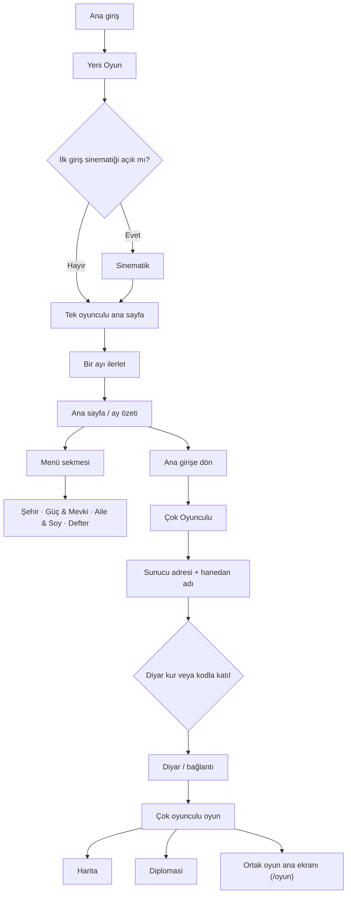

# Ekran Haritası

> İnceleme: `mobile/app/` ve menü tanımları; `feature/online-p5-darbe-zinciri` dalı. Bu çalışma yalnızca envanterdir; uygulama koduna dokunulmadı. Geçişler statik rota/aksiyon taramasına dayanır; koşullu kartlar ve dinamik hedefler oyun durumuna göre değişebilir.

## 1. Ekran envanteri

### Açılış ve yeni hayat

| Ekran / dosya | İşlevi | Nereden, nasıl açılır |
|---|---|---|
| Ana giriş — `app/index.tsx` | Devam etme, yeni hayat ve çok oyunculu girişini sunar. | Uygulama açılışı; buradan `/oyun`, `/yeni-oyun`, `/cok-oyunculu`. |
| Yeni oyun — `app/yeni-oyun.tsx` | Soy, başlangıç koşulları ve karakter tercihleriyle yeni hayatı kurar. | Ana girişte “Yeni Oyun”; kayıt sıfırlama/“Yeni Hayat” eylemleri. Tamamlanınca `/oyun`. Sinematik açıksa önce `/sinematik`. |
| Sinematik — `app/sinematik.tsx` | Giriş/öykü sinematiğini oynatır. | Yeni hayatın ilk giriş akışı veya oyun ayarları; bitince ilgili oyun akışına döner. |

### Tek oyunculu oyun — `app/oyun/`

Oyun kabuğundaki kalıcı sekmeler: **Ana sayfa** (`index`), **Karakter**, **İlişkiler**, **Menü**. Diğer sayfalar çoğunlukla bu sekmelerin menü kartlarından, ana sayfa bildirimlerinden veya birbirleri arasındaki bağlantılardan açılır. Menüdeki kartlar yaş/oyun durumu koşuluyla görünür.

| Ekran / dosya | İşlevi | Nereden, nasıl açılır |
|---|---|---|
| Ana sayfa — `oyun/index.tsx` | Ayı, karakter özetini, gündemi ve bekleyen olayları gösterir. | Yeni oyun/sinematik bitişi; ana sekme; diğer ekranlardan geri dönüş. Buradan karakter, defter, hanedan, örgütler, pazar, hikâyeler, tarih ve çok oyunculu özetine giden bağlamsal kısayollar bulunur. |
| Menü — `oyun/menu.tsx` | Oyun ekranlarını dört grupta toplar: Şehir, Güç & Mevki, Aile & Soy, Defter. | Alt sekme; Şehir başlığı/harita/ayarlar ve listedeki ekranlara geçiş. |
| Karakter — `oyun/karakter.tsx` | Oyuncu karakterinin kimlik, durum ve kişisel bilgilerini gösterir. | Alt sekme; ana sayfa portresi; bazı olay/kişi ekranlarından. |
| İlişkiler — `oyun/iliskiler.tsx` | Karakterin sosyal bağlarını ve ilişki ağını gösterir. | Alt sekme; NPC profilleri, çöpçatanlık ve mahalleye geçiş. |
| Şehir — `oyun/sehir.tsx` | Bulunulan yerin mekân ve faaliyet girişlerini sunar. | Menü kahraman kartındaki “Şehre çık”; harita/geri dönüş bağlantıları. |
| Harita — `oyun/harita.tsx` | Diyar yerleşimlerini ve seyahat hedeflerini gösterir. | Şehir ekranı veya menü kahraman kartı; yer seçimi `diyar/[name]` ekranına gider. |
| Diyar/yer ayrıntısı — `oyun/diyar/[name].tsx` | Seçilen yerleşimdeki seyahat/varış seçeneklerini gösterir. | `oyun/harita` listesinden; işlem tamamlanınca haritaya geri döner. |
| Pazar — `oyun/pazar.tsx` | Alım-satım, pazar ve kervan ticaretini yürütür. | Menü > Şehir; ana sayfadaki aktif kervan kartı. |
| Atölye — `oyun/atolye.tsx` | Üretim ve zanaat işlemlerini sunar. | Menü > Şehir; meslek/üretim bağlamından. |
| Meslek — `oyun/meslek.tsx` | Meslek seçimi, mesleki ilerleme ve meslek durumunu yönetir. | Menü > Şehir; savaş/iş/meslek bağlamındaki bağlantılar. |
| Beceriler — `oyun/beceriler.tsx` | Karakterin beceri ve gelişim puanlarını gösterir. | Menü > Güç & Mevki; mektep ekranı. |
| Emek — `oyun/emek.tsx` | Günlük çalışma/emeğe dayalı eylemleri sunar. | Ayarlar ekranındaki kısayol ve karakter ekranındaki `?ac=emek` bağlantısı. |
| Mektep — `oyun/mektep.tsx` | Yaşa bağlı eğitim ve öğrenim seçeneklerini sunar. | Menü > Şehir; buradan Beceriler ve Karakter'e geçiş. |
| Mülkler — `oyun/mulkler.tsx` | Oyuncunun mülklerini ve mülk yönetimini gösterir. | Menü > Şehir; yaş/mülk koşuluyla görünür. |
| Mahalle — `oyun/mahalle.tsx` | Yakın çevredeki kişileri ve mahalle etkileşimlerini gösterir. | Menü > Şehir; İlişkiler ekranı. Kişi seçimi NPC profiline gider. |
| Haberler — `oyun/haberler.tsx` | Diyar ve dünya gelişmelerini listeler. | Menü > Şehir; haber kartlarının hedefleri ilgili ekranlara gider. |
| Görevler — `oyun/gorevler.tsx` | Aktif görevleri ve görev hedeflerini listeler. | Menü > Şehir; görev satırları kendi hedef rotalarına gider. |
| Örgütler — `oyun/orgutler.tsx` | Oyuncunun katılabileceği/bağlı olduğu örgütleri gösterir. | Menü > Güç & Mevki; ana sayfadaki örgüt/olay bildirimi. |
| Sosyal — `oyun/sosyal.tsx` | Sosyal olayları, söylentileri ve ilişkili kişileri sunar. | Menü > Güç & Mevki; ana sayfadaki söylenti/gündem kartı. Kişi bağlantıları NPC profiline gider. |
| Savaş — `oyun/savas.tsx` | Savaş, çatışma ve askerî eylemleri yönetir. | Menü > Güç & Mevki; rakip/tehdit durumu varsa görünür. Meslek ekranına kısayol içerir. |
| Suç — `oyun/suc.tsx` | Suç, yakalanma ve yargı süreçlerini yönetir. | Menü > Güç & Mevki; bekleyen mahkeme olayı rozetiyle öne çıkar. |
| Hanedan — `oyun/hanedan.tsx` | Hanedan gücü, rakipler ve taht mücadelesini gösterir. | Menü > Aile & Soy; ana sayfadaki hanedan/taht bildirimi. Nesil, NPC ve diplomasi bağlantıları içerir. |
| Nesil — `oyun/nesil.tsx` | Varis seçimi ve sonraki nesle geçişi yönetir. | Hanedan/ana sayfa; ölüm sonrası varis akışı. Seçimden sonra ana oyuna döner. |
| Ocak — `oyun/ocak.tsx` | Varis kalmadığında yeni ocak/soy başlangıcını kurar. | Ölüm/veda akışında varis seçeneği kalmadığında; işlem sonrası ana oyun. |
| Kronik — `oyun/kronik.tsx` | Hanedanın kronik/soy kaydını gösterir. | Menü > Aile & Soy. |
| Hikâyeler — `oyun/hikayeler.tsx` | Ana hikâye kollarının ilerlemesini ve seçimlerini gösterir. | Menü > Defter; ana sayfadaki aktif hikâye çağrısı. |
| Tarih — `oyun/tarih.tsx` | Oyuncunun yaşam olaylarını ve geçmiş kayıtlarını listeler. | Menü > Defter; ana sayfa yaşam defteri/son olaylar; ölüm sonrası anı makarası. |
| Roman — `oyun/roman.tsx` | Karakterin hayatını anlatı biçiminde sunar. | Menü > Defter; ana sayfadaki “Hayatını oku”; ölüm sonrası anma. |
| Başarımlar — `oyun/basarimlar.tsx` | Açılan başarımları ve ilerlemeyi gösterir. | Menü > Defter. |
| Diplomasi — `oyun/diplomasi.tsx` | Tek oyunculu hanedanlar/diyarlar arası diplomatik teklifleri gösterir. | Hanedan ekranındaki diplomasi bağlantısı; NPC/hanedan ayrıntıları. |
| Divan — `oyun/divan.tsx` | Günlük divan/dava ekranını gösterir. | Menü tanımında bilerek kaldırılmış; taranan uygulama rotalarında doğrudan giriş bağlantısı bulunamadı. |
| Çöpçatan — `oyun/copcatan.tsx` | Eşleşme/evlilik adayı bulma hizmetini sunar. | İlişkiler ekranındaki çöpçatan kısayolu. |
| NPC profili — `oyun/npc/[id].tsx` | Tek oyunculu dünyadaki belirli bir kişinin profilini ve etkileşimlerini gösterir. | İlişkiler, mahalle, sosyal, hanedan ve ana sayfa gündemindeki kişi bağlantıları; dinamik `id`. |
| SSS — `oyun/sss.tsx` | Oyun hakkında yardım ve sık sorulan soruları gösterir. | Oyun ayarları ekranındaki yardım bağlantısı. |
| Ayarlar — `oyun/ayarlar.tsx` | Oyun tercihlerini, yardım ve yeni hayat işlemlerini yönetir. | Menü kahramanındaki dişli; menü altındaki ayarlar; ana sayfa. Sinematik, SSS ve Emek bağlantıları içerir. |

### Çok oyunculu — `app/cok-oyunculu/`

| Ekran / dosya | İşlevi | Nereden, nasıl açılır |
|---|---|---|
| Çok oyunculu giriş/lobi — `cok-oyunculu/index.tsx` | Sunucu adresi, hanedan adı, cinsiyet ve diyar koduyla kurma/katılma işlemini başlatır. | Ana girişte “Çok Oyunculu”; geri ile ana giriş. Diyar kur/katıl eylemi `diyar` ekranına gider. |
| Diyar — `cok-oyunculu/diyar.tsx` | Bağlanılan diyarın ilk durumunu/kurulumunu gösterir ve oturumu oyuna aktarır. | Lobi kurma veya kodla katılma; hazır oturumda `/oyun` rotasına geçiş. |
| Çok oyunculu oyun özeti — `cok-oyunculu/oyun.tsx` | Çok oyunculu diyarın oyuncu, siyaset, sefer ve olay özetini gösterir. | Çok oyunculu oyun ana sayfasındaki diyar/özet bağlantısı; geri ile önceki ekrana. |
| Çok oyunculu harita — `cok-oyunculu/harita.tsx` | Çevrimiçi diyarın haritasını gösterir. | `cok-oyunculu/oyun` ekranındaki harita düğmesi; geri ile oyun özetine. |
| Çok oyunculu diplomasi — `cok-oyunculu/diplomasi.tsx` | Çevrimiçi oyuncularla hediye, ittifak, evlilik, düello ve benzeri ilişkileri yönetir. | `cok-oyunculu/oyun` ekranındaki diplomasi düğmesi; geri ile oyun özetine. |

### Ayrı çevrimiçi hayat akışı — `app/online/`

> Bu 32 ekranlık akış, `cok-oyunculu` klasöründeki diyar/oturum akışından ayrı bir rota ağacı. Taramada ana girişten veya tek oyunculu menüden `/online` rotasına giden görünür bir bağlantı bulunamadı; dolayısıyla doğrudan rota/deep link dışında oyuncunun keşfetmesi zor.

| Ekran / dosya | İşlevi | Nereden, nasıl açılır |
|---|---|---|
| Çevrimiçi giriş — `online/index.tsx` | Çevrimiçi hayat için devam/yeni profil başlangıcını sunar. | Kendi akışının kökü; uygulama içinden görünür giriş bağlantısı tespit edilemedi. |
| Profil — `online/profil.tsx` | Çevrimiçi karakterin başlangıç profilini oluşturur/düzenler. | `online` girişinden; devam akışı profil/varis durumuna göre. |
| Yerleşim — `online/yerlesim.tsx` | Oyuncunun yerleşim ve ilk hayat hazırlığını tamamlar. | Profil sonrası; davet ekranına geçiş. |
| Davet — `online/davet.tsx` | Bir çevrimiçi diyara/oyuna davetle katılımı yönetir. | Yerleşim veya profil hazırlığından; başarılı olunca varis/başlangıç akışına. |
| Varis — `online/varis.tsx` | Çevrimiçi hayata giriş/varis başlangıcını onaylar. | Davet/yerleşim sonrası; başlatınca `online/yasam`. |
| Yaşam — `online/yasam.tsx` | Çevrimiçi karakterin ana yaşam ekranını ve eylem kısayollarını sunar. | Varis ekranından; karakter, mahalle, tanıdıklar, debdebe, sipariş, topluluk, hizmet, siyaset, pazar, mülk ve defter bağlantıları. |
| Dönüş — `online/donus.tsx` | Çevrimiçi yaşam döngüsünde dönüş/yeniden başlama adımını sunar. | Yaşam döngüsünün dönüş durumu; devam eylemi `online/yasam`. |
| Karakter — `online/karakter.tsx` | Çevrimiçi oyuncunun hane/karakter bilgilerini gösterir. | Yaşam ekranı; hane üyeleri `kisi/[id]` profillerine gider. |
| Mahalle — `online/mahalle.tsx` | Yerleşimdeki kişileri ve yakın çevreyi listeler. | Yaşam ekranı; kişi kartları `kisi/[id]` profiline gider. |
| Tanıdıklar — `online/tanidiklar.tsx` | Oyuncunun tanıdığı kişileri listeler. | Yaşam ekranı; kişi seçimi `kisi/[id]`. |
| Gelen — `online/gelen.tsx` | Oyuncuya gelen kişi/iletişim kayıtlarını gösterir. | Kişi bağlantılarıyla ilişkili gelenler akışı; kişi profillerine geçiş. Ana yaşam ekranından doğrudan giriş netleştirilmeli. |
| Kişi profili — `online/kisi/[id].tsx` | Çevrimiçi hayattaki NPC/kişi ayrıntısını gösterir. | Karakter, mahalle, tanıdıklar ve diğer kişi bağlantıları; dinamik `id`. |
| Oyuncu profili — `online/oyuncu/[id].tsx` | Başka bir gerçek oyuncunun profilini ve mesleki geçmişini gösterir. | Yaşam/kişi listelerindeki oyuncu referansları; meslek geçmişinden beceri ağacına geçiş. |
| Debdebe — `online/debdebe.tsx` | İtibar, gösteriş ve toplumsal statü görünümünü sunar. | Yaşam ekranı; Levha ekranına geçiş. |
| Levha — `online/levha.tsx` | Çevrimiçi başarı/itibar levhasını gösterir. | Debdebe ve yaşam ekranındaki statü bağlantıları. |
| Hanedan — `online/hanedan.tsx` | Çevrimiçi hanedan ve soy bilgilerini gösterir. | Yaşam ekranındaki hanedan/soy bağlantısı; Kronik'e geçiş. |
| Kronik — `online/kronik.tsx` | Çevrimiçi hanedanın geçmiş kayıtlarını gösterir. | Hanedan ekranı. |
| Meslek — `online/meslek.tsx` | Çevrimiçi meslek seçimi ve ilerlemesini gösterir. | Yaşam, işler ve lonca ekranları; beceri ağacına geçiş. |
| Beceri ağacı — `online/beceri-agaci.tsx` | Seçilen mesleğin beceri dallarını gösterir. | Meslek ve oyuncu profili/mesleki geçmiş bağlantıları; meslek parametresiyle açılır. |
| İşler — `online/isler.tsx` | Çevrimiçi iş/işçilik fırsatlarını listeler. | Yaşam ve lonca/meslek bağlantıları; siparişler ve mesleğe geçiş. |
| Lonca — `online/lonca.tsx` | Meslek loncası ve lonca ilişkilerini gösterir. | Meslek/işler; siparişler ve mesleğe geçiş. |
| Hizmet — `online/hizmet.tsx` | Oyuncunun sunduğu/alabildiği hizmetleri gösterir. | Yaşam ekranındaki hizmet bağlantısı. |
| Siparişler — `online/siparisler.tsx` | Oyuncunun iş/sipariş tekliflerini ve durumlarını gösterir. | Yaşam, işler ve lonca ekranları; kişi profilleri, işler ve loncaya geçiş. |
| Pazar — `online/pazar.tsx` | Çevrimiçi pazar ve ekonomik işlemleri sunar. | Yaşam ekranı; ısmarlama ve deftere geçiş. |
| Ismarlama — `online/ismarlama.tsx` | Pazardan özel sipariş oluşturmayı yönetir. | Pazar ekranı; deftere geçiş. |
| Defter — `online/defter.tsx` | Çevrimiçi ekonomik/işlem kayıtlarını gösterir. | Pazar ve ısmarlama ekranları. |
| Mülk — `online/mulk.tsx` | Oyuncunun çevrimiçi mülklerini listeler. | Yaşam ekranı; mülk seçimi `isletme/[id]` ayrıntısına. |
| İşletme ayrıntısı — `online/isletme/[id].tsx` | Seçilen işletmenin durumunu ve işlemlerini gösterir. | Mülk listesinden; dinamik işletme `id`. |
| Han — `online/han.tsx` | Hanın sosyal alanını ve masalarını gösterir. | Yaşam ekranındaki han bağlantısı; masa seçimi `han/[masa]`. |
| Han masası — `online/han/[masa].tsx` | Belirli han masasındaki oturumu/etkileşimi gösterir. | Han ekranındaki masa kartı; dinamik masa numarası. |
| Siyaset — `online/siyaset.tsx` | Çevrimiçi yerleşimin siyasal durumunu ve seçeneklerini gösterir. | Yaşam ekranındaki siyaset bağlantısı. |
| Topluluk — `online/topluluk.tsx` | Çevrimiçi topluluk/oyuncu etkileşimlerini gösterir. | Yaşam ekranındaki topluluk bağlantısı. |

## 2. Tekrar edenler

- **Harita:** `oyun/harita` ve `cok-oyunculu/harita` aynı temel “diyar haritası” ihtiyacını iki farklı veri/oyun modu için karşılıyor.
- **Diplomasi:** `oyun/diplomasi` (tek oyunculu hanedan/NPC ilişkileri) ile `cok-oyunculu/diplomasi` (gerçek oyuncular arası eylemler) kavramsal olarak aynı bölüm; hedef ve eylem setleri farklı.
- **Kişi/oyuncu profili:** `oyun/npc/[id]`, `online/kisi/[id]` ve `online/oyuncu/[id]` benzer profil/ilişki ayrıntısı sunuyor; tek bir ortak profil şablonu ve tür ayrımı düşünülebilir.
- **Karakter/kimlik:** `oyun/karakter`, `online/karakter` ve `online/profil` karakter bilgisi gösteriyor; ancak biri oyun içi durum, biri çevrimiçi hane, biri başlangıç formu.
- **Kronik/defter/tarih/roman:** `oyun/kronik`, `oyun/tarih`, `oyun/roman`, `online/kronik`, `online/defter` kayıt/geçmiş sunuyor; kapsamları ayrışsa da oyuncu gözünde “kayıtlar” başlığı altında toplanabilir.
- **Pazar/iş/ısmarlama/sipariş:** `oyun/pazar` ile `online/pazar`; ayrıca `online/isler`, `online/ismarlama`, `online/siparisler` ekonomik işlemin farklı adımları. Ayrı modlarda çalışıyorlar fakat bilgi mimarisi benzer.
- **Sosyal çevre:** `oyun/iliskiler`, `oyun/mahalle`, `online/mahalle`, `online/tanidiklar`, `online/gelen` kişi/ilişki listeleri sunuyor; tek oyunculu ve çevrimiçi veri ayrımı korunmalı.
- **Hanedan/soy:** `oyun/hanedan`, `oyun/nesil`, `oyun/kronik` ile `online/hanedan`, `online/kronik` aynı soy temasını farklı modlarda tekrarlıyor.

## 3. Ulaşılamayanlar / çıkmaz sokaklar

- **Kesin tespit:** `oyun/divan.tsx` menüden özellikle çıkarılmış (kaynak yorumunda da belirtiliyor); taranan `mobile/app` içinde bu rotaya giden bir giriş bağlantısı bulunamadı. Şu an yetim ekran.
- **Yüksek olasılıklı kopuk akış:** `online/index.tsx` çevrimiçi akışın kökü; ana girişte yalnızca `/cok-oyunculu` bağlantısı var. Tek oyunculu menüde veya ana girişte `/online` bağlantısı bulunamadı. Ekranlar kendi aralarında bağlı olsa da akış ana oyuncu yolculuğuna bağlanmıyor.
- **Giriş yolu belirsiz:** `online/gelen.tsx` ve `online/donus.tsx` için ekran içi hedefler görüldü; ancak ana yaşam ekranından ilk giriş bağlantısı statik taramada açık biçimde doğrulanamadı.
- **Geri tuşuna bağımlı ekranlar:** Birçok ayrıntı ekranı yalnızca `router.back()` ile kapanıyor. Deep link/soğuk açılışta önceki ekran yoksa kullanıcı için güvenli bir ana hedef görünmüyor; kritik ayrıntılara sabit “ilgili bölüme dön” bağlantısı eklenmesi değerlendirilmeli.
- **Boş ekran değildir:** Menüde yaş/oyun durumu koşuluyla gizlenen sayfalar (ör. Mülkler, Örgütler, Savaş, Suç, Nesil) erişilemez görünse de koşulları sağlanınca açılacak şekilde tasarlanmış.

## 4. Oyuncu gözüyle akış şeması

**Not:** Çok oyunculuya ana girişten doğrudan ulaşılır; tek oyunculu bir ay oynama şartı teknik olarak yok. Şema, istenen “önce bir ay oyna, sonra çok oyunculuya geç” oyuncu yolculuğunu gösterir. MP diyar bağlantısı hazır olunca akış ortak `/oyun` kabuğuna geçer; çok oyunculu özet/harita/diplomasi ayrı rotalardır.

## 5. Tek oyunculuda olup çok oyunculuda olmayanlar

Çok oyunculu mod, tek oyunculunun tüm ekranlarını bire bir kopyalamıyor; ortak `/oyun` kabuğu/ana ekranı kullanılırken çevrimiçi moda özgü diyar, harita ve diplomasi ekranları ayrıdır.

**Tek oyunculuya özgü ekranlar:** Atölye, Beceriler, Başarımlar, Çöpçatan, Divan, Diyar ayrıntısı/seyahat, Emek, Görevler, Haberler, Hanedan, Hikâyeler, İlişkiler, Karakter ayrıntısı, Kronik, Mahalle, Mektep, Menü, Meslek, Mülkler, Nesil, NPC profili, Ocak, Örgütler, Pazar, Roman, Savaş, Şehir, Sosyal, SSS, Suç, Tarih ve tek oyunculu Diplomasi.

**Modlar arasında benzer olup ayrı kalanlar:** Harita, Diplomasi, Karakter/Profil, Kişi profili, Pazar ve Kronik/Defter. Çok oyunculuda bunların bazıları farklı veri modeli ve eylemlerle yeniden yazılmış; bire bir aynı ekran değiller.

## 6. Ek şema: ana gezinme mimarisi

- **Tek oyunculu:** 4 sabit sekme → Ana Sayfa / Karakter / İlişkiler / Menü. Menü içinde 4 kategori → Şehir / Güç & Mevki / Aile & Soy / Defter.
- **Çok oyunculu:** Ana giriş → Lobi → Diyar kur/katıl → ortak oyun kabuğu; oyun özetinden Harita ve Diplomasi alt sayfaları.
- **Ayrı çevrimiçi:** `/online` → Profil → Yerleşim/Davet → Varis → Yaşam; Yaşam ekranından sosyal, ekonomi, meslek, han ve siyaset alt alanları.
- **Yardım/ayarlar:** Tek oyunculu ayarları ana menüden erişilir; SSS, sinematik ve Emek bağlantıları ayarlar altında.
- **İlerleme/ölüm:** Ana oyun → Veda/ölüm → Varis seçimi (`nesil`) veya yeni ocak (`ocak`) → ana oyun.

## 7. Sade bir yapı için öneri (uygulama yapılmadı)

En fazla **5 ana bölüm**:

1. **Ana Sayfa** — ay özeti, bildirimler, hızlı eylemler ve “ayı ilerlet”.
2. **Hayatım** — Karakter, İlişkiler, Mahalle, NPC/oyuncu profilleri, Hanedan, Nesil, Kronik.
3. **Diyar** — Şehir, Harita, Pazar, Atölye, Meslek, Mülkler, Örgütler, Savaş, Suç, Diplomasi.
4. **Kayıtlar** — Tarih, Roman, Hikâyeler, Haberler, Görevler, Başarımlar, Defter; Kronik burada da Hayatım'dan kısayol alabilir.
5. **Çok Oyunculu** — Lobi, Diyar, ortak oyun, Harita, Diplomasi; ayrı `/online` akışı bunun içine alınmalı ya da ürün kapsamı net değilse gizlenmeli.

**Birleştir / sadeleştir:**
- Tek oyunculu ve MP haritalarını tek “Harita” arayüzünde mod verisiyle ayır.
- İki diplomasi ekranını tek “Diplomasi” bölümünde mod/aktör tipine göre ayır.
- Tarih + Roman + Kronik + Defter'i “Kayıtlar” çatısında birleştir; farklı görünümler sekme olsun.
- Mahalle + Tanıdıklar + Gelen'i tek “İnsanlar” alanında filtrelerle sun.
- Karakter + Profil'i tek profil alanı; başlangıç profili ayrı form adımı olsun.
- Pazar + Ismarlama + Siparişler'i tek “Ticaret” alanında alt sekmeler yap.
- **Divan** için gerçek oyun döngüsünde bir giriş/işlev yoksa kaldır; yeniden tasarlanacaksa yalnız makam/olay koşuluyla görünür kıl.
- **Online akışı** ile **Çok Oyunculu** arasındaki ürün farkını netleştir; oyuncuya iki ayrı çevrimiçi giriş sunma.

---
**Kapsam sayımı:** 3 açılış ekranı + 34 tek oyunculu ekran + 5 çok oyunculu ekran + 32 ayrı çevrimiçi ekran = **74 ekran**. Üç `_layout` dosyası gezinme kabuğudur, ekran sayısına dahil edilmedi.
