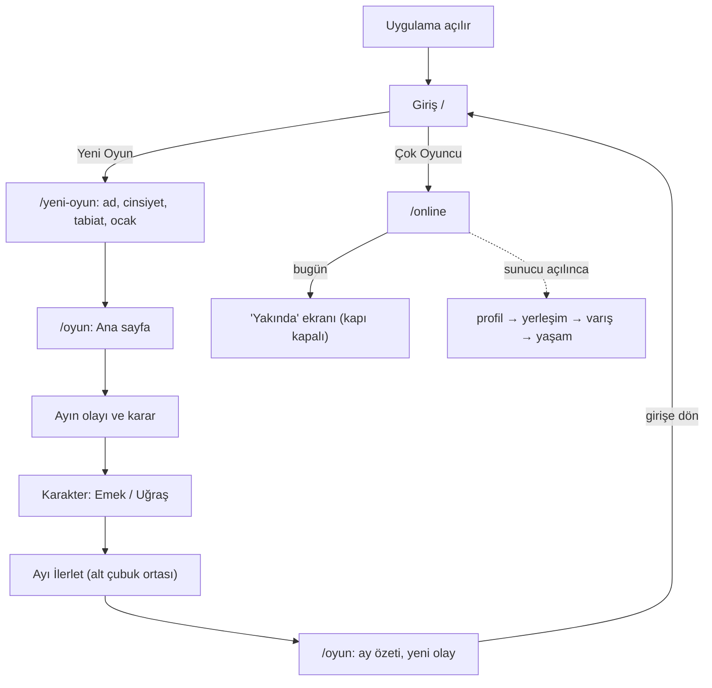
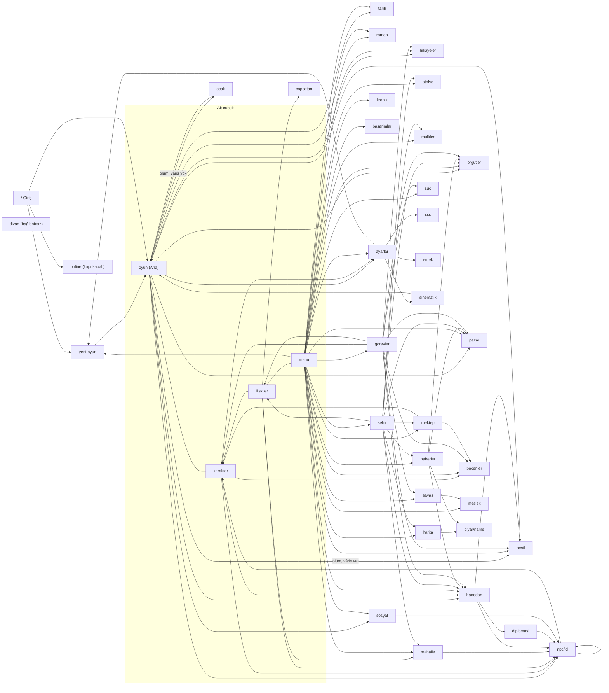
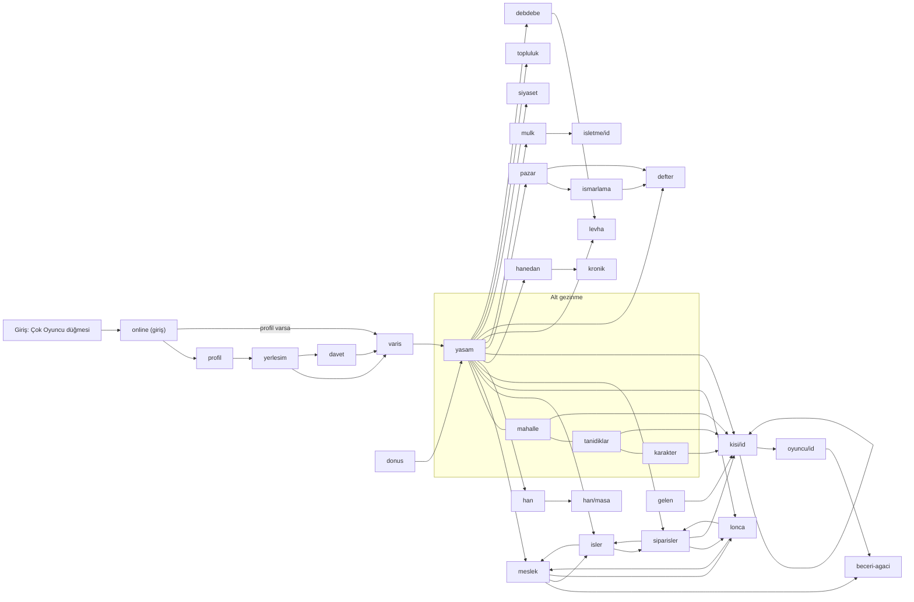
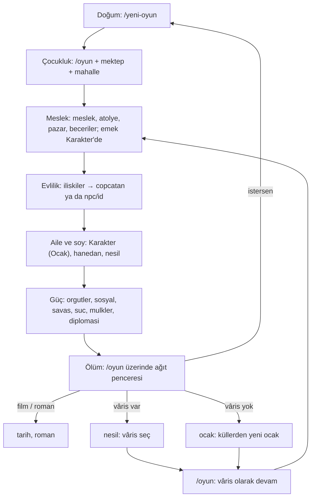
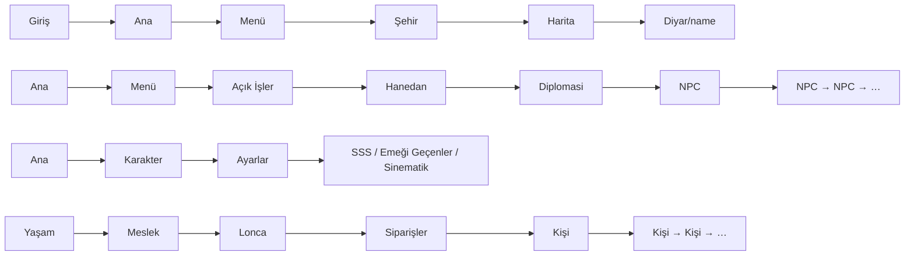

# EKRAN HARİTASI

> 13 Kasım 2026 (eski Diyar çok oyunculu söküldükten ve çevrimiçi dal birleştirildikten sonraki durum).
> Kaynak: `mobile/app/` altındaki 70 ekran dosyası ve koddaki bütün `router.push/replace/back` çağrıları ile
> `lib/` içindeki rota metinleri. "Doğrulanmadı" yazan yerler koddan kesin okunamayan noktalardır.

## 0. Büyük resim

Uygulamada iki alan var; eski üçüncü alan (`cok-oyunculu/`, `lib/mp/`, `server/`) 13 Kasım'da kaldırıldı.

| Alan | Klasör | Ekran | Durum |
|---|---|---|---|
| Tek oyunculu | `app/oyun/` | 35 | Çalışıyor, internet gerekmez. |
| Çok oyunculu (çevrimiçi) | `app/online/` | 32 | Kapalı (`ONLINE_GELISTIRME = false`); girişteki "Çok Oyuncu" düğmesi buraya gelir ve "Yakında" gösterir. Sunucu (`online-server/`) yazılı ama yayında değil. |
| Kök | `app/` | 3 | Giriş, yeni oyun, sinematik. |

İki oyun birbirinden bağımsızdır: ayrı kayıt, ayrı karakter.

## 1. Ekran envanteri

### Kök

| Ekran | Ne işe yarar | Nereden gelinir |
|---|---|---|
| `/` `index.tsx` | Giriş: Devam, Yeni Oyun, Çok Oyuncu. | Uygulama açılışı; yeni oyundan geri. |
| `/yeni-oyun` | Ad, cinsiyet, tabiat, ocak seçip hayatı kurar. | Giriş; Menü, Ayarlar ve ölüm ekranındaki "yeni hayat". |
| `/sinematik` | Açılış sinematiğini yeniden oynatır. | Yalnız Ayarlar. |

### Tek oyunculu — alt çubuk (her yerden tek dokunuş)

| Ekran | Ne işe yarar | Nereden gelinir |
|---|---|---|
| `/oyun` `oyun/index.tsx` | Ana sayfa: ayın olayı, kararlar, gündem, ölüm ve ağıt. | Alt çubuk; Ayı İlerlet düğmesi; giriş, yeni oyun, sinematik, vâris/ocak sonrası. |
| `/oyun/karakter` | Kimlik, göstergeler, emek/uğraş ve 4 sekme (Özellikler, Kuşam, Ocak, Serüven). | Alt çubuk; ana sayfa, Açık İşler, Mektep, NPC, gündem bağlantıları. |
| `/oyun/iliskiler` | Aile, yakın çevre, hasımlar, tanışlar listesi. | Alt çubuk; Şehir, Açık İşler, gündem. |
| `/oyun/menu` | Dört gruplu kapı: Şehir, Güç & Mevki, Aile & Soy, Defter. | Alt çubuk. |
| Ayı İlerlet | Ekran değil; ayı geçirip `/oyun`'a döner (uzun bas: 6 ay). | Alt çubuğun ortası. |

### Tek oyunculu — Menü ve Şehir üzerinden

| Ekran | Ne işe yarar | Nereden gelinir |
|---|---|---|
| `/oyun/sehir` | Şehrin durumu, mekân kartları, bölge ambarı. | Menü başlığı. |
| `/oyun/pazar` | Alım-satım ve pazarlık. | Menü, Şehir, ana sayfa, Açık İşler, Haberler, gündem (borç). |
| `/oyun/atolye` | Üretim ve sipariş. | Menü (reşitse), Şehir. |
| `/oyun/meslek` | Meslek, lonca sınavı, çırak, ustalık. | Menü (reşitse), Çatışma, gündem. |
| `/oyun/mulkler` | Mülk alma ve işletme. | Menü (yaş kapılı), Şehir. |
| `/oyun/mahalle` | Bu ay kim hangi mekânda; uğrama ve akşam sofrası. | Menü, Şehir, İlişkiler. |
| `/oyun/mektep` | Dersler, sınav, hoca. | Menü, Şehir. |
| `/oyun/haberler` | Diyardan haberler; ilgili ekrana götürür. | Menü, Şehir. |
| `/oyun/gorevler` | "Açık İşler": yapılabilecekleri ilgili ekrana bağlayan liste. | Yalnız Menü. |
| `/oyun/harita` | Beylikler ve yerleşimler haritası. | Menü, Şehir, gündem. |
| `/oyun/diyar/[name]` | Seçilen yerleşimin yönetim, vergi, yol bilgisi. | Harita, Haberler. |
| `/oyun/orgutler` | Örgütler ve loncalar, üyelik. | Menü (reşitse), Şehir, ana sayfa, Açık İşler, Haberler. |
| `/oyun/sosyal` | "Mevki & İtibar": mevki basamağı ve nam. | Menü (reşitse), ana sayfa (söylenti). |
| `/oyun/beceriler` | Beceri ağacı. | Menü, Karakter (Özellikler), Mektep, Açık İşler. |
| `/oyun/savas` | "Çatışma": hasım, düello, savaş. | Menü (reşit ya da hasım varsa), Açık İşler, gündem, diyar bildirimi. |
| `/oyun/suc` | "Gölge İşleri": keşif, plan, suç. | Menü (reşitse), Açık İşler. |
| `/oyun/hanedan` | Soy, taht, servet sekmeleri; karar defteri. | Menü, Şehir, ana sayfa, Karakter (Ocak), Açık İşler, Haberler. |
| `/oyun/diplomasi` | Hanedanlar arası teklifler. | Hanedan, diyar bildirimi. |
| `/oyun/nesil` | "Nesil & Vâris": vâris seçimi ve devir önizlemesi. | Menü (kapılı), Hanedan, Açık İşler, ölüm ekranı. |
| `/oyun/ocak` | "Küllerden Yeni Ocak": vârissiz ölümden sonra aynı soyadla yeni hayat. | Yalnız ölüm ekranı (vâris yoksa). |
| `/oyun/kronik` | Hanedan Defteri: ölümden sağ çıkan soy kaydı. | Yalnız Menü. |
| `/oyun/tarih` | Başlığı da "Kronik": bu hayatın günlüğü (önemli, günlük, dünya) ve film şeridi. | Menü, ana sayfa, ağıt ekranı. |
| `/oyun/roman` | "Hayatın Romanı": hayatın anlatı özeti, paylaşım kartı. | Menü, ana sayfa, ağıt ekranı. |
| `/oyun/hikayeler` | "Hikâyelerim": hikâye yaylarının ilerleyişi. | Menü, ana sayfa, Açık İşler. |
| `/oyun/basarimlar` | Başarımlar ve ilerleme oranı. | Yalnız Menü. |
| `/oyun/npc/[id]` | Kişi sayfası: sohbet, anılar, eylemler. | İlişkiler, Mahalle, Hanedan, Diplomasi, Mevki, Karakter (Ocak), Meslek (lonca), ana sayfa, başka bir NPC. |
| `/oyun/copcatan` | Çöpçatan: eş adayı süzme. | Yalnız İlişkiler. |
| `/oyun/ayarlar` | Dil, ses, yeni hayat, yardım bağlantıları. | Ana sayfa, Karakter, Menü. |
| `/oyun/sss` | Nasıl Oynanır. | Yalnız Ayarlar. |
| `/oyun/emek` | "Emeği Geçenler": lisans ve atıflar. | Yalnız Ayarlar. |
| `/oyun/divan` | Günün davası; hüküm ver, lakap kazan, paylaş. | **Hiçbir yerden.** |

### Çok oyunculu (`online/`)

| Ekran | Ne işe yarar | Nereden gelinir |
|---|---|---|
| `/online` | Giriş: Google düğmesi (kapalı), geliştirici oturumu. | Girişteki "Çok Oyuncu" düğmesi; içeride çoğu ekranın "girişe dön"ü. |
| `/online/profil` | Dünyada tek ad ve cinsiyet. | Giriş, Davet, Yerleşim. |
| `/online/yerlesim` | 7 beylikten yerleşim seçimi. | Profil. |
| `/online/davet` | Davet koduyla yerleşime katılma. | Yerleşim. |
| `/online/varis` | İlk varış: sinematik ve "12 yaşında indin" kartı. | Giriş (profil varsa), Yerleşim, Davet. |
| `/online/yasam` | Ana sayfa: dönüş kartı, gerilimler, takat, hızlı geçişler. | Varış, Dönüş, alt gezinme. |
| `/online/mahalle` | Bu ay kim nerede (tek oyunculunun harita bileşeniyle). | Yaşam, alt gezinme. |
| `/online/tanidiklar` | Tanıdık, dost, düşman listesi. | Yaşam, alt gezinme. |
| `/online/karakter` | 6 özellik, beceriler, nam, yol seçimi, hane. | Yaşam, alt gezinme, Mahalle, Kişi. |
| `/online/meslek` | 14 meslek seçimi ya da kademe kartı. | Yaşam, İşler, Lonca, beceri ağacı. |
| `/online/beceri-agaci` | Mesleğin beceri ağacı. | Meslek, Oyuncu profili. |
| `/online/isler` | Beş temel iş ve ambar. | Yaşam, Meslek, Siparişler. |
| `/online/lonca` | 14 mesleğin doluluk tablosu. | Yaşam, Meslek, Siparişler. |
| `/online/siparisler` | Lonca siparişleri ve teslim. | Yaşam, İşler, Lonca. |
| `/online/kisi/[id]` | NPC profili ve sana bakışı. | Mahalle, Tanıdıklar, Yaşam, Karakter, Gelen, Siparişler, başka kişi. |
| `/online/oyuncu/[id]` | Oyuncu profili, teveccüh, armağan vitrini. | Kişi yolu üzerinden; kendi profilin (toplum bileşeni). |
| `/online/gelen` | Gelen kutusu: teklifler, dostluk, söylentiler. | Toplum bileşeni (hangi ekranda durduğu doğrulanmadı). |
| `/online/han` | Yerleşimin hanı ve masalar. | Yaşamdaki han girişi. |
| `/online/han/[masa]` | Masa: koltuklar, sohbet, yemin/sözleşme. | Han. |
| `/online/hanedan` | Soy ağacı, vasiyet, devir. | Yaşamdaki han/hanedan girişi. |
| `/online/kronik` | Yerleşim kroniği. | Yalnız Hanedan. |
| `/online/donus` | 24 saatten uzun yokluktan dönüş ekranı. | Barınma bileşeni. |
| `/online/pazar` | Pazar tahtası: oyuncudan oyuncuya alım satım. | Yaşam, ekonomi bileşeni. |
| `/online/ismarlama` | Ismarlama sipariş verme ve alma. | Pazar, ekonomi bileşeni. |
| `/online/levha` | Ustalar Levhası. | Yaşam, Debdebe, ekonomi bileşeni. |
| `/online/defter` | Ekonomi defteri: gelir gider kayıtları. | Yaşam, Pazar, Ismarlama. |
| `/online/mulk` | Mülklerim: han, dükkân, atölye edinme. | Yaşam, ekonomi bileşeni, İşletme. |
| `/online/isletme/[id]` | İşletme paneli: kasa, personel, vekâlet, tezyin. | Mülklerim. |
| `/online/siyaset` | Bölge siyaseti: makam, darbe, ittifak, bağımsızlık. | Yaşam. |
| `/online/topluluk` | Topluluk ve Meşrep, şenlik, zaviye. | Yaşam. |
| `/online/debdebe` | Debdebe: süs kataloğu ve ücretsiz "Dene" önizlemesi (ödeme kapalı). | Yaşam. |
| `/online/hizmet` | Meslek hizmetleri. | Doğrulanmadı. |

## 2. Tekrar edenler

| Konu | Ekranlar | Sorun |
|---|---|---|
| "Kronik" adı | `/oyun/tarih` ve `/oyun/kronik` | İkisinin başlığı da "Kronik". Biri bu hayatın günlüğü, öbürü hanedan defteri. |
| Hayat kaydı | `tarih`, `roman`, `hikayeler`, `kronik`, `basarimlar` | Beş ayrı "geçmişim" ekranı; oyuncu hangisine bakacağını bilemez. |
| Yönlendirme merkezi | `menu`, `sehir`, `gorevler`, ana sayfa gündemi | Dördü de "şuraya git" listesi. Şehir, Menü'nün Şehir grubunun 9 kartını yeniden gösterir. |
| Aile ve soy | Karakter (Ocak sekmesi), `iliskiler`, `hanedan` (Soy sekmesi), `nesil` | Aynı insanlar dört yerde. |
| İtibar/nam | `sosyal`, Karakter göstergeleri, `orgutler` | Mevki ve nam üç yere dağılmış. |
| "Emek" adı | `/oyun/emek` (lisanslar) ve Karakter'deki Emek paneli (çalışma) | Aynı kelime iki ayrı şey. |
| Mahalle | `/oyun/mahalle`, `/online/mahalle` | Aynı bileşen, iki ayrı ekran. |
| Karakter | `/oyun/karakter`, `/online/karakter` | Aynı iş, ayrı kod. |
| Meslek | `/oyun/meslek` + `beceriler`, `/online/meslek` + `beceri-agaci` | İki ayrı meslek ve beceri sistemi. |
| Hanedan | `/oyun/hanedan`, `/online/hanedan` | Aynı kavram, ayrı ekran. |
| Kişi sayfası | `/oyun/npc/[id]`, `/online/kisi/[id]`, `/online/oyuncu/[id]` | Üç profil ekranı. |
| Pazar ve mülk | `/oyun/pazar` + `mulkler`, `/online/pazar` + `mulk` | Aynı kavram, iki ayrı sistem (tek oyunculu ve çevrimiçi bilerek ayrı). |

## 3. Sorunlu ekranlar

**Ulaşılamayan**
- `/oyun/divan`: koda bağlı tek bir düğme yok. Çalışan, bitmiş bir ekran ama oyuncu göremez.
- `/online` altındaki 32 ekran: giriş düğmesi bağlı ama kapı kapalı, hepsi "Yakında" gösterir. Sunucu açılmadan gerçek veriyle denenemez.

**Tek kapılı (bulması zor)**
- `kronik`, `basarimlar`, `gorevler`: yalnız Menü. `copcatan`: yalnız İlişkiler. `sss`, `emek`, `sinematik`: yalnız Ayarlar.
- `ayarlar`: alt çubukta yok; ana sayfa, Karakter ya da Menü'deki küçük düğmeden.
- `ocak`: yalnız vârissiz ölümde; bu doğru, sorun değil.
- Çevrimiçinde hemen her şey Yaşam ekranından açılır (20'ye yakın çıkış); Yaşam kalabalıklaşıyor.

**Çıkmaz sokak**
- Gerçek çıkmaz yok; her ekranda geri var.
- Çevrimiçi ekranlarda "geri" çoğu yerde `/online` girişine `replace` eder (oturum/yerleşim yoksa). Oturum varken geri davranışı doğrulanmadı.
- Çocuklukta Menü'nün kapalı kartları (atölye, meslek, örgütler, mevki, gölge, mülk) oyuncuya yarım oyun hissi verebilir; kartın gizli mi kilitli mi göründüğü doğrulanmadı.

## 4. Yeni oyuncunun yolu

Bugün yeni oyuncu çok oyunculuda yalnız "Yakında" görür. Oyun içinden girişe dönen açık bir düğme bulunamadı (doğrulanmadı; Android geri tuşu çalışır).

## 5. Tek oyunculuda olup çok oyunculuda olmayanlar

| Özellik | Tek oyunculu | Çok oyunculu (çevrimiçi) |
|---|---|---|
| Ay ilerletme | Var (düğme) | Yok; dünya saati sunucuda |
| Aylık olay ve ikilem | Var | Yok (gerilimler, dönüş kartı var) |
| Karakter | Var | Var (ayrı) |
| İlişkiler / kişi sayfası | Var | Var (tanıdıklar, kişi, oyuncu profili) |
| Mahalle | Var | Var |
| Meslek ve beceri ağacı | Var | Var (14 meslek, ayrı sistem) |
| Mektep | Var | Yok (öğrenme dönemi şeridi var) |
| Pazar | Var | Var (oyuncudan oyuncuya, ısmarlama) |
| Atölye | Var | Yok (işler ve tarifler var) |
| Mülkler | Var | Var (mülk, işletme paneli) |
| Örgütler | Var | Lonca tablosu, topluluk |
| Çatışma / savaş | Var | Yok (siyasette darbe var; düello, kan davası yok) |
| Gölge İşleri (suç) | Var | Yok |
| Mevki & İtibar | Var | Nam karakterin içinde; makam siyasette |
| Hanedan, vâris | Var | Var (vasiyet, devir) |
| Küllerden Yeni Ocak | Var | Yok |
| Çöpçatan / evlilik | Var | Ekranı yok |
| Harita / yerleşim detayı | Var | Yalnız yerleşim seçimi |
| Diplomasi | Var | Siyaset içinde (ittifak, tanınma) |
| Haberler | Var | Yerleşim defteri, kronik |
| Hayat kaydı (günlük, roman, hikâyeler) | Var | Yalnız yerleşim kroniği |
| Başarımlar, Divan | Var | Yok |
| Ayarlar, SSS | Var | Yok |
| Sohbet (yazılı, sesli) | Yok | Var (han masası) |
| Gelen kutusu, davet, oyuncu profili | Yok | Var |
| Debdebe (süs) | Yok | Var (ödeme kapalı) |

## 6. Ek şemalar

### (a) Bütün geçişler

### (b) Bir hayat döngüsü (tek oyunculu)

Çevrimiçi karşılığı: profil → yerleşim → varış (12 yaş) → yaşam → meslek → mülk/işletme → siyaset → hanedan (vasiyet, devir). Evlilik ve ölümün ayrı ekranı yok.

### (c) En derin yollar

- En derin sabit yol 5 dokunuş (Diyar detayı). NPC ve kişi sayfaları birbirine sınırsız zincirlenir.
- Menü → Şehir → mekân: aynı mekâna Menü'den 1, Şehir'den 2 dokunuşla gidilir.
- Açık İşler bir ara katmandır; kendi içeriği yok, başka ekrana atar.

## 7. Sade yapı önerisi (yalnız öneri)

Beş ana bölüm; alt çubuk bunları taşır, ortada Ayı İlerlet kalır.

| Bölüm | Altına girenler | Birleşen / kalkan |
|---|---|---|
| 1. Hayat (ana sayfa) | Olay, karar, gündem, ölüm ve vâris akışı (`nesil`, `ocak`) | `gorevler` kalkar; içeriği zaten gündemde. |
| 2. Ben | `karakter`, `beceriler`, `mektep`, `meslek` | `sosyal` Karakter'e sekme olur. Emek paneli "Çalış" adını alır; `/oyun/emek` "Lisanslar" olur. |
| 3. İnsanlar | `iliskiler`, `mahalle`, `npc`, `copcatan`, `hanedan`, `diplomasi` | Karakter'in Ocak sekmesi ve Hanedan'ın Soy sekmesi tek "Ocak & Soy" olur. |
| 4. Diyar | `sehir` (kapı), `pazar`, `atolye`, `mulkler`, `orgutler`, `savas`, `suc`, `harita`, `diyar/name`, `haberler` | `menu`nün Şehir ve Güç grupları `sehir` ile birleşir; tek mekân listesi kalır. |
| 5. Defter | `tarih`, `roman`, `hikayeler`, `kronik`, `basarimlar`, `divan`, `ayarlar`, `sss` | `tarih` "Günlük", `kronik` "Hanedan Defteri" adını alır; `roman` Günlük'ün sekmesi olur. `divan` buraya bağlanır. |

Çok oyunculu için:
- Tek giriş kuruldu: girişteki "Çok Oyuncu" düğmesi `/online`'a bağlı; eski `cok-oyunculu/*` kaldırıldı.
- Yaşam ekranı 20'ye yakın çıkış taşıyor; aynı beş bölüme ayrılmalı (Yaşam, Karakter+Meslek, Tanıdıklar+Mahalle+Hanedan,
  Yerleşim: İşler+Lonca+Pazar+Mülk+Han+Siyaset, Defter: Kronik+Gelen+Ekonomi defteri), böylece oyuncu iki ayrı oyun öğrenmez.

Sonuç: tek oyunculuda 35 ekrandan `gorevler`, `sosyal`, `menu` ve `roman` ayrı ekran olmaktan çıkar (31); çevrimiçi 32 ekran kalır, yalnız gezinmesi toplanır.
