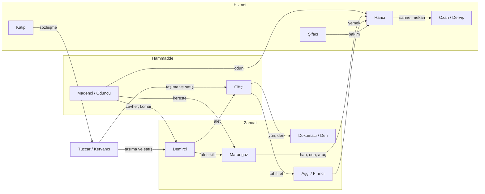

# KRONİKLER ONLINE — Ek A: Meslekler, İlerleme ve Topluluk

**Sürüm:** 0.1 · **Tarih:** 7 Kasım 2026 · **Ana belge:** `KRONIKLER_ONLINE_GDD.md` v0.4
**Durum:** Taslak. Hiçbir madde [KESİN] değildir. Berkay’ın yönlendirdiği maddeler **[UZLAŞI — onay bekliyor]**, geri kalanı **[ÖNERİ]** ve **[PARAMETRE]**dir. Etiketler ana belge §0 ile aynıdır.

> Bu ek, ana belgeyle çelişirse ana belge geçerlidir ve çelişki raporlanır. Online mod SP verisini (stat, kayıt, profil) hiçbir koşulda kullanmaz. SP’deki stat sistemi bu ek için incelenmemiştir.

## 0. Ajan için özet

1. **14 meslek**, 5 aile. Her mesleğin dört sorusu vardır: kim ister, çıktısı ne, ilerleme ne açar, NPC taban hizmeti var mı.
2. **Meslek kilitli sınıf değildir.** Temel iş herkese açık (sade çıktı, düşük hız); usta iş kademeye bağlıdır.
3. **İlerleme üç katmandır:** *Hal* (can, kondisyon, gönül; dalgalanan durum), *Sanat* (çırak → kalfa → usta; sayı değil, imkân açar), *Meşrep* (seçilen huy).
4. **Gizli sayı yok:** Her değer bir karar ya da imkân açar ve etkisi arayüzde yazılıdır.
5. **Topluluk:** küçük aidiyet birimleri (hami, usta-çırak, ortak dertler, şenlik, müdavim, lonca/ahi). Günlük seri yok, katılmamak ceza değil.
6. **Alınmayan:** Şehir Kroniği akışı (kalabalıkta seline döner), günlük seri, zorunlu katılım.
7. Fazlar **E1–E7**; ana belgenin Faz numaralarına dokunmaz, ön koşulları belirtilmiştir.
8. Zaman 12 gerçek saat = 1 oyun ayı. Ustalık gerçek günler alır; parayla atlama yok (D-14).

## 1. Meslekler

### 1.1 Tek sınav

Bir meslek ancak dört soruya cevap verebiliyorsa vardır:

1. Ona **kim ihtiyaç duyar** (oyuncu, NPC, kurum)?
2. **Somut çıktısı** ne?
3. Geliştikçe **ne açılır**?
4. O oyuncu yokken **NPC taban hizmeti** var mı?

### 1.2 Liste ve ana belgeyle eşleme [UZLAŞI — onay bekliyor]

| # | Meslek | Aile | Ana belge §8 karşılığı |
|---|---|---|---|
| 1 | Çiftçi | Hammadde | Çiftçi / çoban |
| 2 | Madenci / oduncu | Hammadde | **Yeni** (zincirin başı) |
| 3 | Demirci | Zanaat | Demirci / zanaatkâr |
| 4 | Marangoz / yapı ustası | Zanaat | Aynı |
| 5 | Dokumacı / deri ustası | Zanaat | Terzi / dokumacı / deri ustası |
| 6 | Aşçı / fırıncı | Zanaat | Aşçı / değirmenci / fırıncı |
| 7 | Hancı | Hizmet | Hancı / mekân sahibi (han, hamam, şerbethane tek mülk çekirdeği) |
| 8 | Şifacı | Hizmet | Şifacı / hekim / ebe |
| 9 | Ozan / derviş | Hizmet | **Yeni** (haber, moral, gönül) |
| 10 | Kâtip / haberci | Hizmet | Haberci / kâtip / tercüman |
| 11 | Tüccar / kervancı | Ticaret | Tüccar / kervancı + rehber |
| 12 | Arabulucu | Toplum | Diplomat / arabulucu / yargıç (yargıç D-28’e ertelendi) |
| 13 | Asker | Toplum | Asker / komutan + izci |
| 14 | Divan görevlisi | Toplum | Hükümdar / bey / divan görevlisi |

Hükümdarlık ve bey **makamdır**, meslek değil. Lonca/mahalle/hane temsilcisi **kademedir** (§3.7). Hoca, sarraf ve ayrı hamamcı rolleri yoktur: eğitim her mesleğin kendi işidir, sarraf (kredi) ekonomi oturunca sonraya kalır.

### 1.3 Tedarik zinciri şeması



### 1.4 Meslek kartları [ÖNERİ]

Dallar örnektir; ajan isimleri sabit kabul etmez, ihtiyaca göre uyarlar.

| Meslek | Kim ister | Çıktı | Sanat dalları (3) | NPC taban hizmeti |
|---|---|---|---|---|
| Çiftçi | Herkes, aşçı, dokumacı, tüccar | Tahıl, sebze, hayvan, yün, süt, av | Ekin · Sürü ve av · Ambar | NPC çiftlikler temel gıda; kıtlıkta fiyat yükselir |
| Madenci / oduncu | Demirci, marangoz, han ve hamam | Cevher, kömür, kereste, odun, taş | Maden · Orman · Taş ocağı | NPC ocak/orman sade hammadde |
| Demirci | Çiftçi, madenci, asker, hancı | Alet, onarım, silah, zırh, kilit | Alet ve onarım · Silah ve zırh · İnce işçilik | NPC demirci temel alet/onarım |
| Marangoz / yapı ustası | Hancı, mülk sahipleri, tüccar | Yapı, mobilya, tezyin, araç, köprü | Yapı · Tezyin · Araç ve köprü | NPC usta temel bakım |
| Dokumacı / deri ustası | Herkes, asker, binek sahipleri | Kumaş, giysi, eyer, çizme, çadır, sancak | Kumaş · Deri · Çadır ve sancak | NPC sade giysi |
| Aşçı / fırıncı | Herkes, han, şenlik | Ekmek, yemek, şerbet, ziyafet | Fırın ve değirmen · Mutfak · Şerbet ve saklama | NPC fırın temel erzak |
| Hancı | Yolcular, yeni gelenler, toplantı yapanlar | Konaklama, yemek, masa, etkinlik, hamam | Konaklama · Etkinlik · Muhasebe | NPC han misafirhane ve oda (ana belge §18) |
| Şifacı | Yaralı, hasta, yorgun | İlaç, bakım, doğum, kondisyon toparlama | Hekimlik · Ebelik ve bakım · Şifalı otlar | NPC şifacı temel bakım |
| Ozan / derviş | Hancı, halk, dertli oyuncu | Moral, gönül toparlama, haber ve türkü | Sahne · Gönül · Haber | NPC ozan han sahnesinde |
| Kâtip / haberci | Sözleşme yapanlar, tüccar, kurum | Sözleşme, mektup, ilan, defter, güvenli teslimat | Yazı · Haber (ulak) · Tercüme ve defter | NPC kâtip temel mektup/sözleşme |
| Tüccar / kervancı | Üreticiler, şehirler arası alıcılar | Alım-satım, taşıma, rota bilgisi | Alım-satım · Kervan · Yol bilgisi | NPC tüccar temel arz |
| Arabulucu | Uyuşmazlığı olanlar, kurumlar | Uzlaşma, tazminat, ateşkes, ittifak teklifi | Uzlaştırma · Elçilik · Hüküm (D-28, ertelendi) | NPC arabulucu küçük yerel uyuşmazlık |
| Asker | Kurumlar, kervanlar, şehirler | Nöbet, korunma, sefer, keşif | Nöbet ve düzen · Sefer · Keşif | NPC garnizon taban savunma (ana belge §10) |
| Divan görevlisi | Beylik, kurumlar | Vergi, bütçe, düzen, meclis | Hazine · Nizam · Meclis | NPC görevli temel kamu hizmeti |

### 1.5 Temel iş / usta iş [UZLAŞI — onay bekliyor]

Demirci gidip ağaç kesebilir. Kural: **temel iş herkese açık, ustalık verimi ve kaliteyi açar.**

- **Temel iş:** odun kesmek, taş toplamak, ot ve yün temin etmek, su taşımak. Herkes yapar; hız düşük, çıktı sade.
- **Usta iş:** ilgili mesleğin kademesine bağlı: yüksek verim, sert odun, nadir damar, yüksek kalite, toplu sipariş.
- **Fırsat maliyeti:** Demircinin odun keserken harcadığı zaman, demir işleyerek kazanacağı zamandır. Çoğu durumda oduncudan satın almak ucuz kalır; ticaret zorlamadan doğar.
- **Azalan getiri:** aynı kaynak için tekrar eden iş azalan getiri verir (ana belge §5 anti-farm).
- **Yan sanat:** oyuncu bir yan sanatı yarı hızda ilerletebilir.
- **Meslek değiştirme ustalığı silmez;** geri dönüşte toparlanma hızlıdır [PARAMETRE].
- Zincirin ilk halkaları (hammadde) için NPC taban arzı vardır; oyuncu hammadde sağlamak zorunda değildir.

## 2. İlerleme: Hal, Sanat, Meşrep

Online karakterde “stat artırma” yoktur. İlerleme üç ayrı katmandır; hiçbirinde gizli sayı olmaz. Her değer bir karar ya da imkân açar ve etkisi arayüzde yazılıdır.

```
HAL (durum)            SANAT (ustalık)              MEŞREP (huy)
can · kondisyon ·      çırak → kalfa → usta         3 eksende seçim
gönül                  + şaheser                    (puan harcama yok)
dalgalanır             imkân açar                   NPC tepkisini ve
                       (sayı artırmaz)              olay seçeneklerini
                                                    değiştirir
```

### 2.1 Hal [ÖNERİ]

| Gösterge | Ne anlatır | Düşünce ne olur | Toparlayanlar |
|---|---|---|---|
| Can | Hayatta kalma | Ölüm kuralları ana belge §11 (ölüm mümkün ama zor); evsizlik tabanı %10 (ana belge §18) | Şifacı, konaklama |
| Kondisyon | İş gücü | Üretim ve yolculuk yavaşlar | Han/hamam konaklaması, dinlenme, şifacı |
| Gönül | Moral | Sosyal seçenekler ve ilişki kazanımı daralır | Ozan/derviş, şenlik, dost sohbeti |

- Değerler **büyümez, dalgalanır**. Stat enflasyonu yoktur.
- Her göstergenin en az bir **görünür** etkisi vardır; etkisiz gösterge eklenmez.
- Evsizlik zincirinin “stat debuff”ı **kondisyon ve gönüle** uygulanır; can ayrıdır ve %10 tabanı korunur. Debuff değerleri [PARAMETRE, D-21].
- Etkenler: evsizlik, hastalık, yorgunluk, olaylar. Hepsi nedeniyle birlikte gösterilir.

### 2.2 Sanat [ÖNERİ]

- **Kademe:** Çırak → Kalfa → Usta. Süreler gerçek günlerle ölçülür [PARAMETRE]; parayla atlama yok (D-14).
- **Dallar:** Her meslekte 3 dal (§1.4). Çırak bir dal seçer, Kalfa ikinci dalı, Usta üçüncüyü açar.
- **Düğüm = imkân:** Bir kademe sayı artırmaz; yeni tarif, hizmet, kalite düzeyi, sipariş türü ya da toplu iş açar.
- **İlerleme kaynağı:** gerçek iş (üretim ve hizmet teslimi), eğitim emri (arka plan işi), usta-çırak ilişkisi.
- **İcazet ve şaheser:** Usta olurken oyuncu isimli bir eser (şaheser) üretir. Eser karakterin geçmişinde ve şehrin **Ustalar Levhası**nda (statik kayıt, akış değil) görünür.
- **Ana ve yan sanat:** biri tam, diğeri yarı hızda ilerler. Meslek değiştirmek ustalığı silmez.
- Eğitim emri iki tarafa da hız verir (usta-çırak); sosyal bağ kurduğu için teşvik edilir.

### 2.3 Meşrep [ÖNERİ]

Üç eksen; oyuncu her eksende bir yöne yaklaşır. Her uç bir avantaj ve bir bedel taşır.

| Eksen | Uçlar | Örnek etki |
|---|---|---|
| Elcömertliği | Cömert ↔ Hesaplı | Cömert: hayır işlerinde nam kazancı yüksek, kasada tutmak zor. Hesaplı: pazarlıkta iyi, hayırdan nam az |
| Cesaret | Temkinli ↔ Gözü pek | Temkinli: riskli olayda uyarı alır, fırsatı kaçırır. Gözü pek: riskli seçenekler açılır, yakalanma ağır |
| Gurur | Mütevazı ↔ Gururlu | Mütevazı: halkta güven. Gururlu: makam ve statü seçeneklerinde avantaj, hakaret/husumet hassasiyeti |

- Meşrep **puan harcama değil, seçimdir**; NPC tepkilerini ve olay seçeneklerini değiştirir (ana belge §6).
- Etkiler arayüzde yazılıdır (“Cömertsen şu açılır, şunu kaybedersin”).
- İlk seçim öğrenme döneminin sonunda yapılır. Yeniden seçim kuralı [AÇIK KARAR D-32].

### 2.4 Çıraklık turu [ÖNERİ]

İlk 6 günlük öğrenme döneminde (D-03) oyuncu üç mesleği ikişer gün yaşayarak dener (2 gün = 4 oyun ayı), sonunda ana sanatını seçer. Bu, menü seçtirmek yerine meslekleri deneyerek keşfettirir. Turun içeriği `OYNANIS_TASARIMI.md` §3 ve yaş eşikleri (12/13/16) ile uyumlandırılır [AÇIK KARAR D-33].

## 3. Topluluk ve aidiyet

### 3.1 İlke

Oyuncu bir bütünün parçası olduğunu **küçük aidiyet birimlerinden** hisseder: bir hami, bir usta, bir han, bir grup, ortak bir dert. Günlük seri yok; katılmamak ceza değil (ana belge §5 K-09). Başarı ölçütleri: ilk 7 günde bir masada oturup bir hami/usta/han/loncaya bağlanan oyuncu oranı; hami eşleşme oranı; ortak dert katkı oranı.

### 3.2 Hami (sponsor) [UZLAŞI — onay bekliyor]

Deneyimli bir oyuncu, yeni gelen bir oyuncuyu **hami** olarak ağırlar. Barınma sistemine oturur: ana belge §18’deki “misafir daveti” konaklama sayılır.

- Hami **akçe değil nam** kazanır; para aktarımı yoktur.
- Nam, yalnız çırağın tanımlı aşamalarında verilir: ilk barınma, ilk sanat kademesi, ilk sözleşme [PARAMETRE]. Bir hami aynı anda en fazla N çırağa bakar [PARAMETRE].
- Sömürü önlemi: hami ve çırak aynı hesap kümesi olamaz; günlük nam tavanı vardır.
- Davet edilen arkadaş davet edenin yerleşiminde başlar (D-05); davet eden doğal hami adayıdır.

### 3.3 Usta-çırak [ÖNERİ]

Meslek içinde eğitim: çırak ustanın iznini ister; eğitim emri iki tarafa da hız verir; usta kademe ilerlemesinde çırağın aşamasına göre küçük nam alır. Hami sosyal sponsordur, usta meslek öğretmenidir; ikisi aynı kişi olabilir.

### 3.4 Ortak dertler [ÖNERİ]

Kıtlık, haydut tehdidi, salgın, hasat gibi bölge olaylarında farklı meslekler farklı katkı verir.

| Meslek | Örnek katkı |
|---|---|
| Çiftçi | Erzak |
| Şifacı | Bakım |
| Madenci/oduncu, demirci | Malzeme, alet |
| Asker | Nöbet |
| Kâtip | Kayıt, ilan |
| Tüccar | Tedarik, taşıma |
| Ozan/derviş | Moral |

- Katkı **eşzamanlı çevrimiçi olmayı gerektirmez**; olayın açık penceresi boyunca yapılır [PARAMETRE].
- Katkılar olay başına “Ortak Dert Defteri”nde isimle anılır (statik liste, akış değil).
- Eşik karşılanırsa etki hafifler; karşılanmazsa **bölge göstergeleri** (arz, moral) düşer. Oyuncu karakteri ceza görmez.

### 3.5 Şenlikler [ÖNERİ]

Önceden ilan edilmiş, birkaç gerçek gün açık pencereli bayram ve şenlikler [PARAMETRE]. Katkı (yemek, süs, hayır) hem topluluk anı hem Debdebe yüzeyidir (ana belge §19: hayır eseri, Cömertler Levhası). Kaçırmak ceza değildir.

### 3.6 Müdavim [ÖNERİ — hanlar oyunculara açıldıktan sonra, Faz 12+]

Oyuncu bir hanın düzenli ziyaretçisi olur; hancı onu tanır, plakasında rozet çıkar. Rozet gün serisiyle değil, **aylar içindeki ziyaret sayısıyla** kazanılır; yani girişe zorlamaz.

### 3.7 Lonca / ahi zaviyesi (5–30 kişi) [ÖNERİ — Faz 17]

Küçük grup: özel masa, ortak kasa (emanet), ortak arma (kozmetik), usta-çırak, **ahi başı** kademesi. Ana belge §8’deki “lonca temsilcisi” rolüne mekanik kazandırır. Faz 7 (kurum) ve Faz 12 (mülk) ön koşuldur.

### 3.8 Alınmayanlar

- **Şehir Kroniği akışı:** kalabalıkta seline döner. Yerine yalnız “çevrenle ilgili önemli olay” özeti, dönüş özeti içinde (ana belge §12, §18).
- Günlük seri, zorunlu katılım, katılmamaya ceza.

## 4. Uygulama fazları (E1–E7)

Ana belge Faz numaralarına dokunmaz. Ajan her seferinde yalnız istenen E fazını uygular.

| Faz | Çıktı | Ön koşul | Tamamlanma ölçütü |
|---|---|---|---|
| E1. Hal göstergeleri | Can, kondisyon, gönül veri alanı ve arayüz; evsizlik zinciri bağlantısı | Ana belge Faz 1, 2 | Her göstergenin görünür etkisi var; SP verisi okunmuyor; ölüm kuralı ana belge §11’e uyuyor |
| E2. Meslek dikey dilimi | 3 meslek (çiftçi, madenci/oduncu, demirci), zincir (odun/cevher → demir → alet → çiftçi), temel iş / usta iş, çıraklık turu | Ana belge Faz 3; E1 | Demirci ağaç kesebiliyor (sade çıktı); azalan getiri çalışıyor; NPC taban arzı var; temel iş kilitli değil |
| E3. Sanat sistemi | Kademe, dallar, eğitim emri, usta-çırak, şaheser, Ustalar Levhası | Ana belge Faz 6; E2 | Süreler parametre; parayla atlama yok; yan sanat yarı hızda; ustalık meslek değişiminde silinmiyor |
| E4. Kalan meslekler | 11 meslek, aile aile; NPC taban hizmetleri | Ana belge Faz 6–9; E3 | Her meslek §1.1 dört soru testini geçiyor; hiçbir hizmet tek oyuncunun çevrimiçi olmasına bağlı değil |
| E5. Meşrep | 3 eksen seçimi; NPC tepki ve olay seçenekleri bağları | Ana belge Faz 4, 5 | Etki arayüzde yazılı; gizli sayı yok; her uç bedel taşıyor |
| E6. Topluluk I | Hami (misafir daveti, nam kuralı, sömürü önlemi), ortak dertler | Ana belge Faz 14 (hami), Faz 8–9 (ortak dert); E3 | Hami para almıyor; hami–çırak aynı hesap kümesi olamıyor; ortak dert katkısı eşzamanlı çevrimiçi gerektirmiyor |
| E7. Topluluk II | Şenlik, müdavim, lonca/ahi zaviyesi | Ana belge Faz 12, 17 | Müdavim rozeti seri gerektirmiyor; şenliği kaçırmak ceza değil |

## 5. Kabul ölçütleri

- Dört soru testi: Her mesleğin talebi, çıktısı, ilerleme açılımı ve NPC taban hizmeti yazılı ve çalışıyor.
- Temel iş herkese açık; usta iş kademeye bağlı; azalan getiri uygulanıyor.
- Hal göstergeleri dalgalanıyor, büyümüyor; her biri görünür bir sonuç doğuruyor.
- Sanat kademeleri sayı artırmıyor, imkân açıyor; süre parayla atlanmıyor.
- Meşrep seçimleri arayüzde açıklanmış; her ucun bir bedeli var.
- Hami para almıyor; nam yalnız tanımlı aşamalarda verilir; alt hesap sömürüsü sınırlı.
- Ortak derde katkı eşzamanlı çevrimiçi olmayı gerektirmiyor; başarısızlık oyuncu karakterini cezalandırmıyor.
- Şenlik, ortak dert ve müdavim katılmamayı cezalandırmıyor.

## 6. Riskler

| Risk | Oyuncuda görünen sorun | Cevap |
|---|---|---|
| 14 meslek yine fazla gelir | Hepsi yarım kalır | İlk dilim 3 meslek (E2); kalanlar aile aile |
| Hammadde oyuncuya bağlı kalır | Tek oduncu yokken zincir durur | NPC taban arzı |
| Ustalık süresi çok uzun | Oyuncu sıkılır | Usta-çırak ve eğitim emri hızlandırır; süreler alfada ölçülür |
| Hami sömürüsü | Alt hesapla nam çiftçiliği | Aşamaya bağlı nam, günlük tavan, hesap kümesi kontrolü |
| Ortak dert cezalandırıcı hissettirir | Oyuncu “yükümlülük” sanar | Etki bölge göstergelerine düşer; karakter ceza almaz |
| Meşrep seçimi tuzak olur | Oyuncu yanlış seçtiğini düşünür | Her ucun avantajı ve bedeli arayüzde açık |
| Yeni gösterge etkisiz kalır | Süs olur | “Etkisiz gösterge eklenmez” kuralı |
| Ana belge ile çelişki | Ajan hangisine uyacağını bilemez | Çelişkide ana belge geçerli; çelişki raporlanır |

## 7. Karar kaydı

### [UZLAŞI — onay bekliyor]

| Konu | Karar |
|---|---|
| 14 meslek listesi | §1.2’deki liste; hoca ve sarraf yok; hükümdarlık makamdır. |
| Temel iş / usta iş | Meslek kilitli sınıf değildir. |
| Hami | Nam kazanır, akçe değil; sömürü önlemi ile. |

### [ÖNERİ]

Hal / Sanat / Meşrep yapısı, çıraklık turu, dallar, ortak dertler, şenlik, müdavim, lonca/ahi (§2–3).

### [AÇIK KARAR]

| Karar | Öneri | Bağlı faz |
|---|---|---|
| D-30 kademe süreleri | Gerçek gün cinsinden alfada ölçülür | E3 |
| D-31 dal sayısı ve adları | 3 dal örnek; ihtiyaca göre | E3, E4 |
| D-32 meşrep yeniden seçimi | Büyük yaşam olaylarında yeniden seçim | E5 |
| D-33 çıraklık turu ve yaş eşikleri | `OYNANIS_TASARIMI.md` §3 ile uyum | E2 |
| D-34 hami sınırları | Eşzamanlı çırak sayısı, nam miktarı, günlük tavan | E6 |
| D-35 ortak dert sonuç şiddeti | Yalnız bölge göstergeleri; üst sınır | E6 |
| D-36 şenlik penceresi | Birkaç gerçek gün; ölçümle | E7 |
| D-37 yargıç/hüküm dalı | D-28 ile birlikte karar | E4 |

## 8. Claude Code istemleri

Genel kalıp:

> `KRONIKLER_ONLINE_GDD.md` ve `KRONIKLER_ONLINE_GDD_EK_A_MESLEK_VE_TOPLULUK.md`yi oku. Bu görev yalnız **Faz E[numara]** kapsamındadır; ana belgenin “Ajan için özet”, §0 ve ilgili bölümü ile bu ekin ilgili bölümü yeterlidir. Online karakteri SP verisinden kesin ayır; SP stat sistemini kullanma. **[AÇIK KARAR]** maddelerini kesinleştirme. Önce mevcut kodda ilgili online girişleri hedefli incele; sonra en küçük uçtan uca dilimi uygula. Gizli sayı ekleme; her değerin etkisini arayüzde göster. Ücretli servis, deploy, commit, push yapma. Gerçekten çalıştırdığın doğrulamayı raporla.

**E2 ek koşulu:** Demirci ağaç kesebilmeli (sade çıktı, azalan getiri); NPC taban arzı olmadan zinciri bitirme.

**E3 ek koşulu:** Süreleri [PARAMETRE] olarak tut; parayla atlama ekleme.

**E6 ek koşulu:** Hami para almasın; nam yalnız tanımlı aşamalarda; hami–çırak aynı hesap kümesi olamasın; ortak dert katkısı eşzamanlı çevrimiçi gerektirmesin.

## 9. Ana belgeye etkiler (onay sonrası)

- **§8 rol tablosu** §1.2’deki 14’lü liste ile yenilenir.
- **§14 veri alanları:** `Vocation`, `CraftBranch`, `SkillRank`, `Masterwork`, `Apprenticeship`, `Condition` (hal), `Temperament` (meşrep), `Patronage` (hami), `CommonCause`, `Festival`.
- **§20 fazları:** E1–E7 eklenir; Faz 0–9 numaraları korunur.
- **§23 karar kaydı:** D-30…D-37 eklenir.
- **§18 evsizlik:** “stat debuff” ifadesi kondisyon ve gönül olarak netleşir.
